# Página do admin

Este documento explica o acesso à página do admin, a consulta com pesquisa e paginação, a edição e exclusão de usuários e a exclusão de comentários.

Os caminhos começam na pasta principal do projeto, onde está **index.js**. As linhas indicadas para os prints consideram os arquivos comentados utilizados nesta documentação. Se o código mudar, use também o nome da função para localizar o trecho.

## Objetivo da página

Em **private/admin/admin.html**, o admin encontra as opções de consulta de usuários, comentários e relatórios.

As operações disponíveis são:

- Consultar usuários com pesquisa e paginação.
- Editar nome, e-mail, tipo e avatar de uma conta.
- Excluir outras contas.
- Consultar comentários com pesquisa e paginação.
- Excluir comentários.
- Consultar os logs registrados pelo sistema.

A página não possui edição de comentários nem edição ou exclusão de logs.

As aulas continuam sendo mantidas nos arquivos Markdown. Não existe uma ferramenta de criação ou edição de aulas nessa página.

O funcionamento dos relatórios está detalhado em **DOC_LOGS.md**.

**Print da página inicial do admin:**

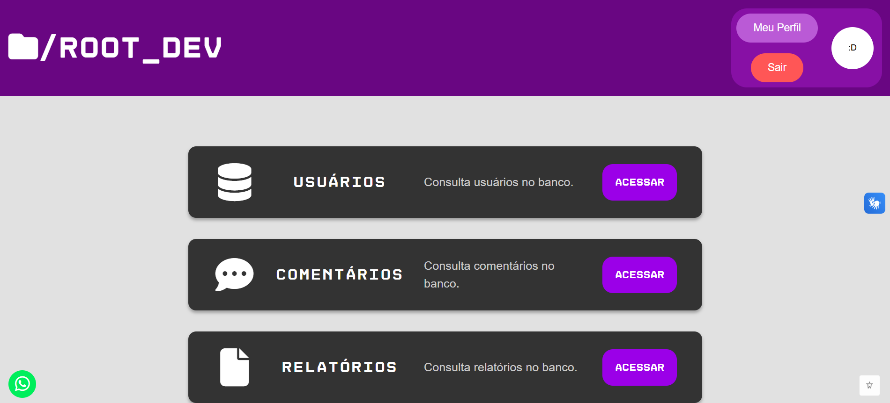

## Arquivos que participam do funcionamento

- **public/admin/loginAdm.html:** formulário de acesso do admin.
- **private/admin/admin.html:** estrutura da página protegida.
- **private/admin/admin.js:** consultas, pesquisa, paginação e montagem dos formulários.
- **routes/admRoutes.js:** rotas de acesso e manutenção.
- **middleware/verificarAdmin.js:** verificação da sessão e do tipo de usuário.
- **controller/admController.js:** validação das operações e preparação das respostas.
- **model/userModel.js:** consulta, atualização e exclusão de usuários.
- **model/comentarioModel.js:** consulta e exclusão de comentários.
- **model/logModel.js:** gravação e consulta dos logs.
- **validacoes/usuarioValidacao.js:** regras dos dados dos usuários.
- **public/admin/admin.css:** responsividade das consultas.
- **public/styles/cadastro-login.css:** responsividade do formulário de edição.
- **service/autenticacaoService.js:** verificação das credenciais e da exigência de acesso administrativo.
- **service/criptografiaService.js:** comparação da senha com o hash armazenado.
- **utils/sessao.js:** criação e salvamento da sessão após o login.
- **utils/normalizarUsuario.js:** preparação dos dados antes da validação da edição.
- **utils/paginacao.js:** validação dos parâmetros e montagem das respostas paginadas.
- **public/scripts/navbar-auth.js:** atualização dos controles da navegação.
- **public/scripts/sessao-cliente.js:** consulta compartilhada da sessão no navegador.

## Como o login do admin é enviado

Em **public/admin/loginAdm.html**, o formulário envia **POST /adm/login** com e-mail e senha.

Esse acesso utiliza e-mail. O campo não oferece a busca por nome de usuário utilizada no login comum.

Em **routes/admRoutes.js**, a rota encaminha os dados para **loginAdm**, de **controller/admController.js**.

A criação do 1º admin é explicada no **README.md**. Essa página de login não transforma uma conta comum em admin.

**Print do login do admin:**

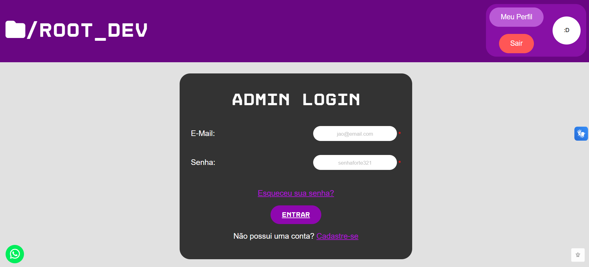

## Como as credenciais são verificadas

Em **controller/admController.js**, **loginAdm(req, res, next)** lê o corpo da requisição e chama:

```js
autenticacaoService.autenticar(
    dados.email,
    dados.senha,
    true,
    (erro, resultado) => {
```

A função **autenticar**, de **service/autenticacaoService.js**, também é utilizada pelo login comum.

O terceiro argumento, **true**, indica que esse acesso exige uma conta administrativa.

Antes de consultar o banco, o service verifica se:

- E-mail e senha são textos.
- A identificação não fica vazia depois de **trim()**.
- A senha não está vazia.
- A senha não ultrapassa **72 bytes em UTF-8**.

Dados recusados nessa etapa recebem um resultado com status **400**.

Como o acesso exige admin, o service utiliza **buscarPorEmail**, de **model/userModel.js**. A identificação é enviada com os espaços das extremidades removidos.

Quando encontra a conta, utiliza **compararHash**, de **service/criptografiaService.js**, para conferir a senha com o hash armazenado.

Depois de confirmar a senha, verifica se **user_tipo** é igual a **admin**.

Os resultados possíveis são:

- Dados iniciais inválidos: status **400**.
- Conta não encontrada ou senha incorreta: status **401**.
- Credenciais corretas de uma conta sem permissão administrativa: status **403**.
- Credenciais e tipo aceitos: objeto com ID, nome, tipo e avatar.

A mensagem de conta não encontrada é a mesma utilizada para senha incorreta.

A senha e o hash não fazem parte do objeto de sucesso.

Falhas internas na consulta ou na comparação são entregues ao controller, que as encaminha por **next(erro)**.

**Print da verificação de acesso do admin:**

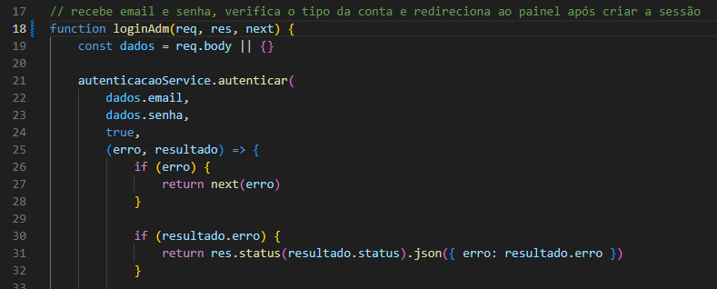

## Como o acesso é concluído

Em **controller/admController.js**, depois de receber os dados autenticados, **loginAdm** chama:

```js
iniciarSessao(req, resultado.usuario, (erroSessao) => {
```

A função **iniciarSessao**, de **utils/sessao.js**:

1. Regenera a sessão.
2. Atribui os dados autenticados a **req.session.usuario**.
3. Salva a sessão antes de continuar.

Se a criação ou o salvamento falhar, o controller encaminha o erro por **next(erroSessao)**.

Quando a sessão é salva, registra **Login realizado no acesso do admin** por **model/logModel.js**.

Depois, redireciona para **/adm/painel**.

Se a gravação do log falhar, o erro é mostrado no terminal e o redirecionamento continua.

O funcionamento da criação da sessão está detalhado em **DOC_GLOBAL.md**.

**Print da sessão e do redirecionamento do admin:**

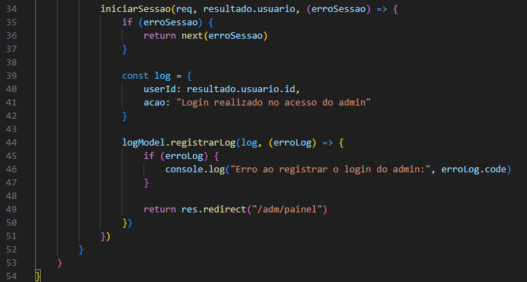

## Como as rotas são protegidas

Em **routes/admRoutes.js**, as rotas do painel, do script protegido e das operações administrativas utilizam **verificarAdmin** antes do controller.

Em **middleware/verificarAdmin.js**, a função começa verificando se existe **req.session.usuario**.

Sem usuário na sessão, responde com status **401**.

Quando existe sessão, utiliza seu ID para consultar a conta por **buscarPorId**, de **model/userModel.js**.

Essa consulta ocorre em cada requisição que passa pelo middleware.

Se o banco apresentar uma falha, o middleware encaminha o erro por **next(erro)**.

Se a conta não existir mais, remove **req.session.usuario** e responde com status **401**.

Quando encontra a conta, atualiza os dados da sessão com ID, nome, tipo e avatar atuais.

Depois, verifica o tipo retornado pelo banco:

- Tipo diferente de **admin**: status **403**.
- Tipo **admin**: **next()** permite continuar para o controller.

As recusas utilizam respostas JSON com a propriedade **erro**.

A autorização não depende apenas dos dados antigos da sessão ou dos botões disponíveis na página.

Se uma conta perder o tipo administrativo, a próxima requisição protegida consulta essa alteração e recusa o acesso.

**Print da proteção das rotas:**

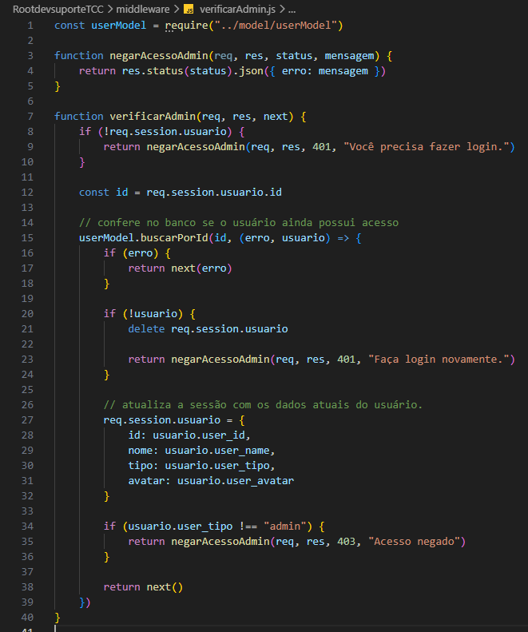

## Como o HTML e o script protegidos são enviados

Em **routes/admRoutes.js**, as rotas **/painel** e **/admin.js** também utilizam **verificarAdmin**.

Em **controller/admController.js**:

- **enviarPainel(req, res):** envia **private/admin/admin.html**.
- **enviarAdminJs(req, res):** envia **private/admin/admin.js**.

As funções usam **res.sendFile** para entregar os arquivos.

Em **private/admin/admin.html**, o script é carregado pelo link **/adm/admin.js**. Ele não é carregado diretamente de uma pasta pública.

**Print das rotas do admin:**

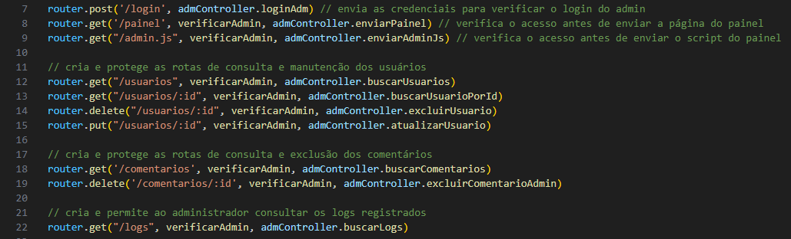

## Como as áreas da página são controladas

Em **private/admin/admin.js**, o objeto **elementosPainel** guarda referências a:

- **tabelaConsulta:** área que recebe as consultas.
- **admInicio:** opções iniciais da página.
- **botaoVoltar:** controle para retornar ao início.
- **formEdicao:** área do formulário de edição.

No mesmo arquivo, existem 3 funções de organização:

- **abrirConsulta():** mostra o botão de voltar, esconde as opções iniciais e limpa as áreas de consulta e edição.
- **abrirEdicao():** limpa as áreas antes de montar o formulário.
- **voltarInicio():** limpa as áreas abertas e mostra novamente as opções iniciais.

Essas funções alteram a interface. Elas não consultam o banco nem enviam respostas ao servidor.

**Print do controle das áreas da página:**

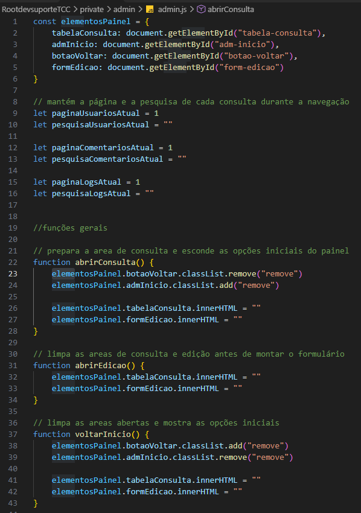

## Como as respostas do painel são lidas

Em **private/admin/admin.js**, **lerRespostaAdmin(resposta)** concentra a leitura do JSON e o tratamento das recusas de acesso.

Primeiro, lê:

```js
const dados = await resposta.json()
```

Depois, verifica se o status é **401** ou **403**.

Nesses casos:

- Mostra um alerta com a mensagem recebida ou um texto padrão.
- Encaminha o navegador para **/admin/loginAdm.html**.
- Retorna **null**.

As funções que utilizam esse resultado verificam se ele é nulo antes de continuar:

```js
const dados = await lerRespostaAdmin(resposta)

if (!dados) {
    return
}
```

Nos outros status, a função devolve o JSON recebido.

Isso não significa que a operação funcionou. O código que chamou a função ainda verifica **resposta.ok** para decidir entre o tratamento de sucesso e o de erro.

A função é compartilhada pelas consultas, pela edição e pelas exclusões do painel.

## Como a consulta de usuários começa

Em **private/admin/admin.js**, **mostrarUsuarios(pesquisa = "", pagina = 1)** recebe o termo e a página desejada.

Quando é chamada sem argumentos, consulta a página 1 sem filtro.

A função chama **abrirConsulta**, mostra uma mensagem de carregamento e prepara o link:

```js
const endereco = `/adm/usuarios?pesquisa=${encodeURIComponent(pesquisa)}&pagina=${pagina}`
```

**encodeURIComponent** prepara o termo para ser inserido no link.

Depois, envia o fetch e utiliza **lerRespostaAdmin** para ler a resposta. Se a função devolver **null**, interrompe o processamento. Nos outros casos, confere **resposta.ok** antes de montar a consulta.

Os valores de pesquisa e página ficam guardados em **pesquisaUsuariosAtual** e **paginaUsuariosAtual**. Eles são reutilizados ao navegar ou atualizar a consulta.

**Print da solicitação de usuários:**

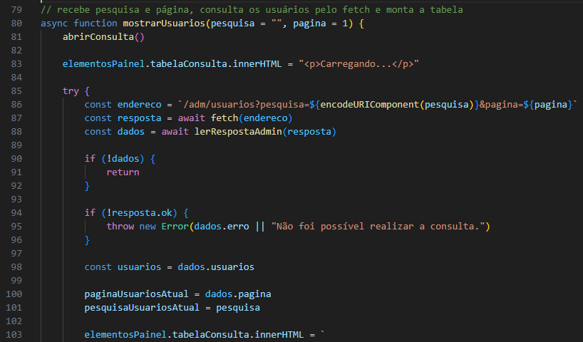

## Como o controller prepara a paginação

Em **controller/admController.js**, **buscarUsuarios(req, res, next)** utiliza **lerConsulta**, de **utils/paginacao.js**:

```js
const consulta = lerConsulta(req.query)
```

A função compartilhada prepara pesquisa, página, limite e deslocamento.

Quando não são informados, a pesquisa recebe texto vazio e a página recebe **1**.

A validação exige:

- Pesquisa em formato de texto.
- Página recebida como texto formado somente por dígitos.
- Número da página inteiro seguro e maior ou igual a **1**.
- Deslocamento inteiro seguro.

Se os parâmetros forem recusados, **lerConsulta** retorna **null** e o controller responde com status **400**.

O limite atual é de **10 registros por página**.

O deslocamento é calculado por:

```js
const deslocamento = (pagina - 1) * LIMITE_POR_PAGINA
```

Assim:

- Página **1**: deslocamento **0**.
- Página **2**: deslocamento **10**.
- Página **3**: deslocamento **20**.

Quando os parâmetros são válidos, o controller obtém:

```js
const { pesquisa, limite, deslocamento } = consulta
```

Essa preparação também é utilizada pelas consultas administrativas de comentários e logs.

**Print da validação da paginação:**

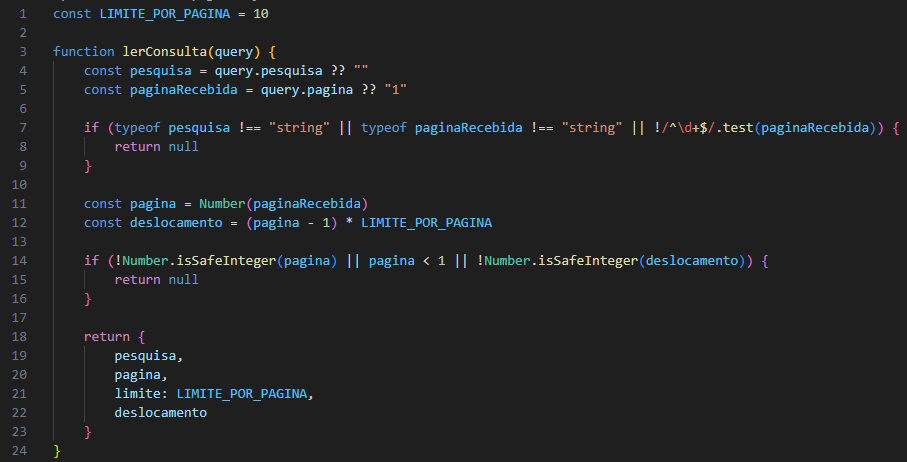

## Como a consulta usa o limite no banco

Em **model/userModel.js**, **buscarTodosUsuarios(pesquisa, limite, deslocamento, callback)** recebe os valores preparados pelo controller.

Quando existe pesquisa, o SQL procura correspondências em:

- Nome.
- E-mail.
- Tipo de usuário.
- Id convertido para texto.

A consulta utiliza **LIKE** com o termo entre **%**. Isso permite encontrar o termo dentro do valor de um campo.

**CAST(user_id AS CHAR)** permite comparar o id como texto.

Os valores são enviados separadamente ao SQL, pelos parâmetros da consulta.

Ao final, a consulta utiliza:

```sql
ORDER BY user_id ASC
LIMIT ? OFFSET ?
```

**ORDER BY** organiza os registros pelo id. **LIMIT** restringe a quantidade retornada. **OFFSET** pula os registros anteriores à página solicitada.

O banco devolve apenas o trecho solicitado, em vez de enviar todos os usuários para o navegador.

## Como o sistema identifica a próxima página

Em **controller/admController.js**, **buscarUsuarios** solicita um registro além do limite:

```js
userModel.buscarTodosUsuarios(pesquisa, limite + 1, deslocamento, (erro, usuarios) => {
```

Como o limite exibido é **10**, a consulta pode devolver até **11 registros**.

Quando a consulta funciona, o controller utiliza **montarPagina**, de **utils/paginacao.js**:

```js
return res.json(
    montarPagina("usuarios", usuarios, consulta)
)
```

A função compartilhada prepara:

- **usuarios:** lista limitada aos primeiros 10 registros.
- **pagina:** número da página consultada.
- **temProxima:** verdadeiro quando a consulta encontrou mais registros que o limite exibido.

O registro adicional não é incluído na lista enviada ao navegador.

Esse funcionamento não calcula o total de páginas. Ele informa se existem mais resultados depois da página atual.

Se o model devolver um erro, o controller o encaminha por **next(erro)**.

**Print da identificação da próxima página:**

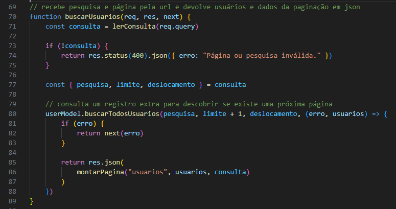

## Como os usuários são exibidos

Em **private/admin/admin.js**, **mostrarUsuarios** monta a estrutura da consulta com pesquisa, tabela e paginação.

Depois, **forEach** percorre os usuários recebidos.

Para cada usuário, **insertAdjacentHTML("beforeend", ...)** acrescenta uma linha com células e botões.

**lastElementChild** encontra a linha recém-criada, e **querySelectorAll("td")** encontra suas células.

Os valores são preenchidos com **innerText**:

```js
colunas[0].innerText = usuario.user_id
colunas[1].innerText = usuario.user_name
colunas[2].innerText = usuario.user_email
colunas[3].innerText = usuario.user_tipo
colunas[4].innerText = usuario.user_avatar
```

Os botões recebem eventos que chamam **editarUsuario** ou **excluirUsuario** com o id daquele registro.

Se a lista estiver vazia, a tabela apresenta a mensagem de que nenhum usuário foi encontrado naquela página.

**Print do preenchimento das linhas:**

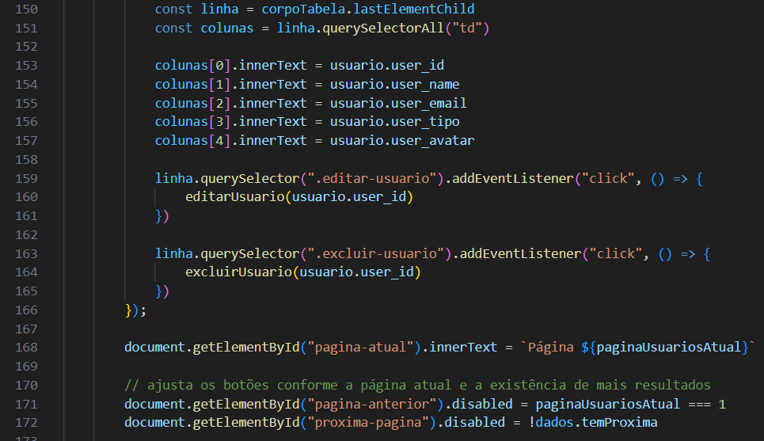

**Print da consulta de usuários:**

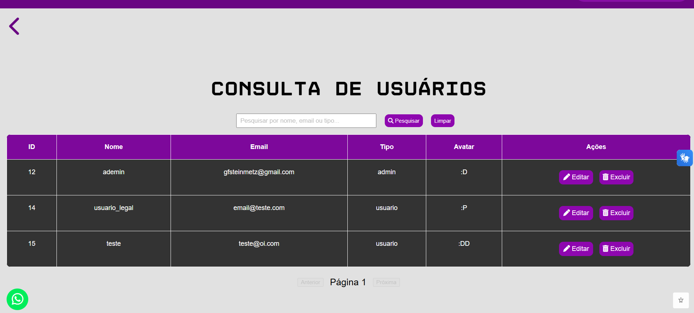

## Como a navegação e a pesquisa funcionam

Em **private/admin/admin.js**, **mudarPaginaUsuarios(direcao)** recebe:

- **-1:** voltar uma página.
- **1:** avançar uma página.

A função soma esse valor à página atual e impede resultados menores que 1. Depois, chama **mostrarUsuarios** mantendo a pesquisa.

Na montagem da consulta:

- Anterior fica desabilitado na página 1.
- Próxima fica desabilitado quando **temProxima** é falso.

Em **pesquisarUsuarios(event)**, **preventDefault** impede o envio comum do formulário. A função lê o campo e chama **mostrarUsuarios(pesquisa, 1)**.

Uma nova pesquisa começa na página 1 para não reutilizar uma posição de outra consulta.

**limparPesquisa()** chama **mostrarUsuarios("", 1)**, removendo o filtro.

**Print das funções de pesquisa de usuários:**

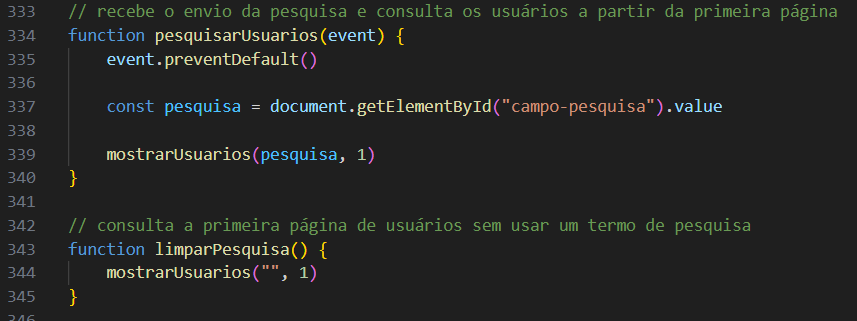

## Como o formulário de edição é aberto

Em **private/admin/admin.js**, **editarUsuario(id)** recebe o id escolhido e consulta **GET /adm/usuarios/:id**.

Em **controller/admController.js**, **buscarUsuarioPorId(req, res, next)** verifica se o parâmetro contém somente dígitos e se sua conversão resulta em um inteiro seguro maior que zero.

Um ID recusado recebe status **400**.

Quando o ID é aceito, chama **buscarPorId**, de **model/userModel.js**. Falhas na consulta são encaminhadas por **next(erro)** ao tratamento centralizado.

O model consulta os dados sem selecionar **user_pass**.

- Se ocorrer erro, o controller responde com 500.
- Se a conta não existir, responde com 404.
- Se a conta existir, devolve seus dados em JSON.

De volta a **private/admin/admin.js**, **editarUsuario** chama **abrirEdicao** e monta o formulário com nome, e-mail, tipo e avatar.

Essa operação não oferece alteração de senha.

## Como a prévia do avatar funciona na edição

Em **private/admin/admin.js**, os elementos do formulário são criados depois da consulta.

Por isso, **editarUsuario** busca o campo de avatar somente após inserir o formulário:

```js
const campoAvatar = document.getElementById("edit-avatar")

campoAvatar.value = usuario.user_avatar || ""

campoAvatar.addEventListener("input", atualizarPreviewAvatarAdm)

atualizarPreviewAvatarAdm()
```

A chamada final mostra o avatar atual antes de qualquer digitação.

No mesmo arquivo, **atualizarPreviewAvatarAdm()** lê **edit-avatar** e preenche **avatar-previa** com **innerText**. Quando o campo está vazio, utiliza **:D**.

**Print da ligação da prévia do avatar:**

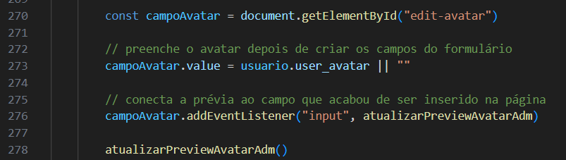

**Print da edição de usuário:**

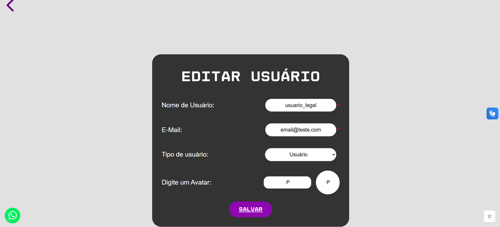

## Como a edição é enviada

Em **private/admin/admin.js**, **salvarEdicao(event, id)** recebe o envio do formulário e o id da conta editada.

A função utiliza **event.preventDefault**, lê os campos e monta **usuarioAtualizado**.

Depois, envia **PUT /adm/usuarios/:id** com o corpo em JSON.

O objeto contém:

- **nome**
- **email**
- **tipo**
- **avatar**

Se o avatar estiver vazio, o script envia **:D**.

**Print do envio da edição:**

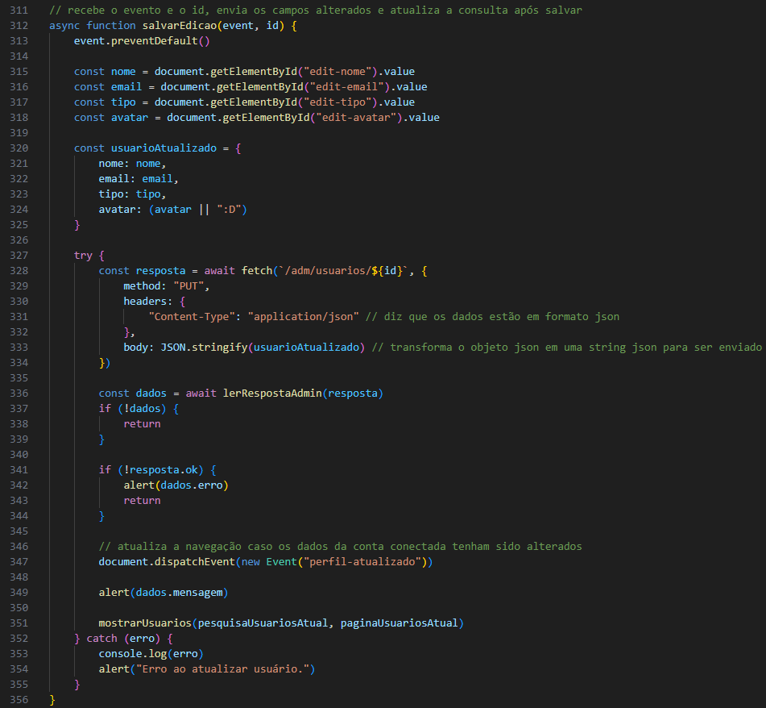

## Como o controller valida a edição

Em **controller/admController.js**, **atualizarUsuario(req, res)** recebe o id pela rota e os campos por **req.body**.

A função verifica se o id é um inteiro seguro maior que 0.

Antes da validação, o controller utiliza **normalizarUsuario**, de **utils/normalizarUsuario.js**:

```js
const usuario = normalizarUsuario({
    nome: dados.nome,
    email: dados.email,
    tipo: dados.tipo,
    avatar: dados.avatar
})
```

A função prepara nome, e-mail e avatar sem modificar o objeto original.

Nome e e-mail têm os espaços das extremidades removidos quando são textos. O avatar também é ajustado e recebe **:D** quando está ausente ou vazio.

O tipo é preservado para a verificação específica do controller.

Depois, nome, e-mail e avatar passam por **validarDadosUsuario**, de **validacoes/usuarioValidacao.js**.

A validação confere as regras sem alterar os valores.

O tipo é verificado separadamente e precisa ser **usuario** ou **admin**.

Depois, o controller chama **buscarUsuarioDuplicado**, de **model/userModel.js**, ignorando o id da conta editada.

- Dados inválidos: status 400.
- Nome ou e-mail de outra conta: status 409.
- Falha ao consultar ou atualizar: status 500.
- Conta não encontrada na atualização: status 404.

O controller também trata **ER_DUP_ENTRY** caso o banco identifique duplicidade durante o UPDATE.

**Print da validação dos campos e do tipo:**

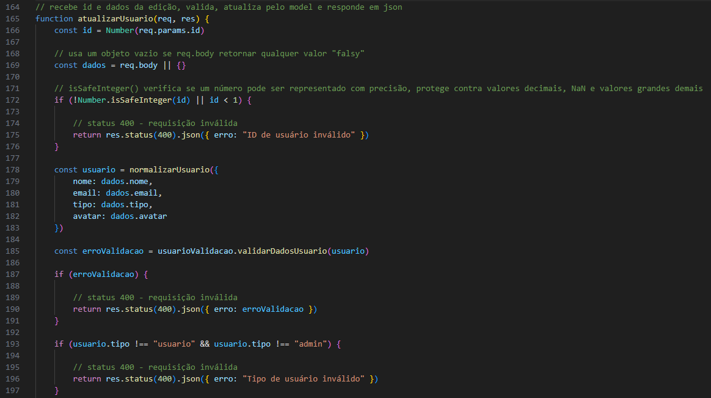

## Como a edição é gravada e concluída

Em **model/userModel.js**, **atualizarUsuario(id, usuario, callback)** atualiza nome, e-mail, tipo e avatar pelo id informado.

A função devolve o resultado ao controller.

Em **controller/admController.js**, **atualizarUsuario** registra a ação com:

- O id do admin que realizou a operação.
- A descrição da alteração.
- O id da conta editada dentro da descrição.

Depois, devolve a mensagem de sucesso.

Em **private/admin/admin.js**, depois de receber sucesso, **salvarEdicao** dispara:

```js
document.dispatchEvent(new Event("perfil-atualizado"))
```

O script **public/scripts/navbar-auth.js** recebe esse evento e solicita uma nova consulta da sessão por **consultarSessao(true)**.

Isso atualiza a navegação caso a edição tenha alterado os dados da conta conectada.

Não existe uma chamada direta de **salvarEdicao** para **verificarLogin()**.

Por fim, o script mostra a mensagem de sucesso e retorna à consulta, mantendo a pesquisa e a página utilizadas.

## Como um usuário é excluído

Em **private/admin/admin.js**, **excluirUsuario(id)** pede confirmação e envia **DELETE /adm/usuarios/:id**.

Em **controller/admController.js**, **excluirUsuario(req, res)** verifica se o id é válido.

A função também impede a exclusão da própria conta por essa consulta:

```js
if (id === Number(req.session.usuario.id)) {
    return res.status(400).json({ erro: "Você não pode excluir sua própria conta" })
}
```

A exclusão do próprio perfil possui outro fluxo, explicado em **DOC_PERFIL.md**.

Depois das verificações, o controller chama **excluirUsuario**, de **model/userModel.js**.

**Print das verificações para excluir um usuário:**

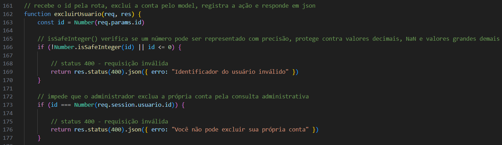

## Como os vínculos afetam a exclusão

Em **model/userModel.js**, **excluirUsuario** executa o DELETE da conta.

As regras das chaves estrangeiras determinam o destino dos registros vinculados:

- Comentários: removidos com **ON DELETE CASCADE**.
- Recuperações: removidas com **ON DELETE CASCADE**.
- Logs anteriores: preservados com **ON DELETE SET NULL**.

Essas regras precisam acompanhar a estrutura do banco.

Em **controller/admController.js**, falhas devolvidas pelo model são encaminhadas por **next(erro)** ao tratamento centralizado.

Quando **affectedRows** é **0**, o controller responde com status **404**, informando que o usuário não foi encontrado.

O fluxo considera as regras de exclusão definidas na estrutura atual do banco.

Depois da remoção, o controller registra o id do admin e identifica a conta excluída na descrição do log.

Em **private/admin/admin.js**, a consulta é atualizada mantendo a pesquisa e a página.

Se a exclusão retirar o último registro daquela página, ela pode ficar vazia. O código não retorna automaticamente para a página anterior.

## Como os comentários são consultados

Em **private/admin/admin.js**, **mostrarComentarios(pesquisa = "", pagina = 1)** consulta **GET /adm/comentarios**.

Em **controller/admController.js**, **buscarComentarios(req, res, next)** utiliza as mesmas funções compartilhadas da consulta de usuários:

- **lerConsulta:** valida pesquisa e página e calcula o deslocamento.
- **montarPagina:** limita a lista e informa se existe uma próxima página.

O limite exibido é de **10 comentários**. O controller solicita até **11 registros** ao model para identificar a próxima página.

A resposta contém **comentarios**, **pagina** e **temProxima**.

Parâmetros inválidos recebem status **400**. Falhas na consulta são encaminhadas por **next(erro)**.

Em **model/comentarioModel.js**, **buscarTodosComentarios** permite pesquisar por:

- Texto do comentário.
- Nome do autor.
- Categoria.
- Tópico.
- Id do comentário.

A consulta relaciona os comentários aos usuários e ordena por data decrescente e id decrescente.

## Como a consulta de comentários é montada

Em **private/admin/admin.js**, **mostrarComentarios** cria as linhas e preenche os valores com **innerText**.

A consulta mostra:

- Id.
- Autor.
- Categoria.
- Tópico.
- Texto.
- Data.
- Ação de exclusão.

A data é apresentada com:

```js
new Date(comentario.com_data).toLocaleString("pt-BR")
```

**mudarPaginaComentarios**, **pesquisarComentarios** e **limparPesquisaComentarios** controlam a navegação e o filtro.

A lógica é equivalente à consulta de usuários, mas utiliza variáveis próprias para preservar o estado dos comentários.

**Print do preenchimento dos comentários:**

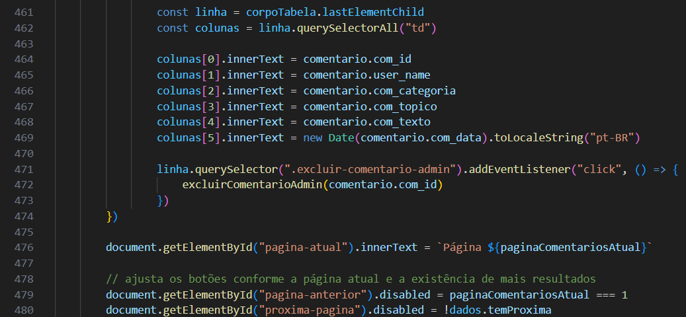

**Print da consulta de comentários:**

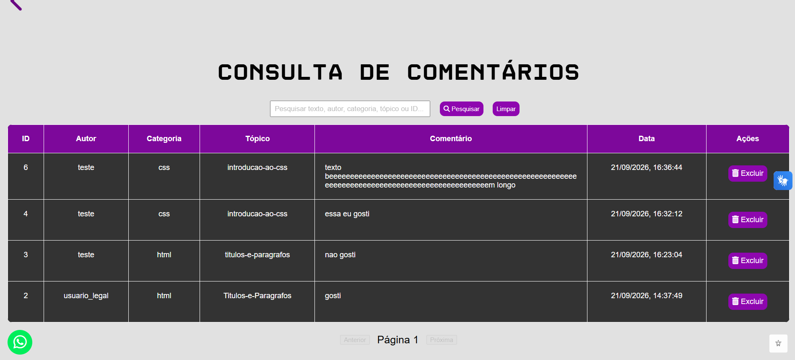

## Como o admin exclui um comentário

Em **private/admin/admin.js**, **excluirComentarioAdmin(id)** pede confirmação e envia **DELETE /adm/comentarios/:id**.

A função utiliza **lerRespostaAdmin** para ler o JSON e tratar os status **401** e **403**. Se essa função devolver **null**, interrompe o processamento. Nos outros casos, verifica **resposta.ok** antes de mostrar o resultado e atualizar a consulta.

Em **controller/admController.js**, **excluirComentarioAdmin(req, res)** valida o id e chama a função correspondente de **model/comentarioModel.js**.

O model exclui pelo id do comentário. Nessa operação, não exige que o admin seja o autor, pois a autorização depende da rota protegida.

Se nenhum registro for removido, o controller responde com 404. Se ocorrer falha no banco, responde com 500.

Depois da exclusão, registra a ação com o id do admin e o id do comentário na descrição.

No navegador, a consulta é carregada novamente mantendo o filtro e a página.

**Print da solicitação de exclusão de comentário:**

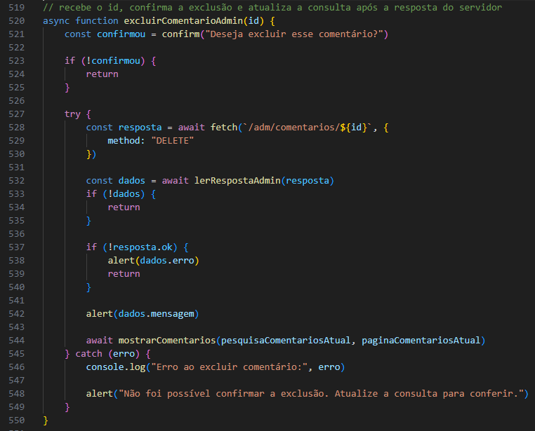

## Como os relatórios são acessados

Em **private/admin/admin.js**, **mostrarLogs(pesquisa = "", pagina = 1)** consulta **GET /adm/logs** e monta a lista de registros.

As funções **mudarPaginaLogs**, **pesquisarLogs** e **limparPesquisaLogs** controlam a página e o filtro dessa consulta.

Em **controller/admController.js**, **buscarLogs** prepara a paginação e chama **buscarTodosLogs**, de **model/logModel.js**.

Essa consulta não possui botões de edição ou exclusão. Os detalhes da gravação e da apresentação estão em **DOC_LOGS.md**.

## Como as tabelas se adaptam às telas

Em **public/admin/admin.css**, a responsividade das consultas utiliza uma área de rolagem ao redor da tabela.

As regras principais são:

- **#tabela-consulta** com **min-width: 0:** permite que a área encolha.
- **.tabela-rolagem** com **overflow-x: auto:** mantém a rolagem horizontal dentro dessa área.
- **.tabela-admin** com **min-width: 800px:** preserva espaço para as colunas, mesmo quando a tela é menor.
- **overflow-wrap: anywhere:** permite quebrar textos longos nas células.

Assim, a tabela pode ser rolada horizontalmente sem exigir que toda a página tenha a mesma largura.

A paginação utiliza **flex-wrap: wrap**, permitindo reorganizar seus controles quando falta espaço.

Até 700 pixels, o formulário de pesquisa passa a se organizar em coluna. O formulário de edição também utiliza as regras compartilhadas de **public/styles/cadastro-login.css**.

**Print das regras de rolagem:**

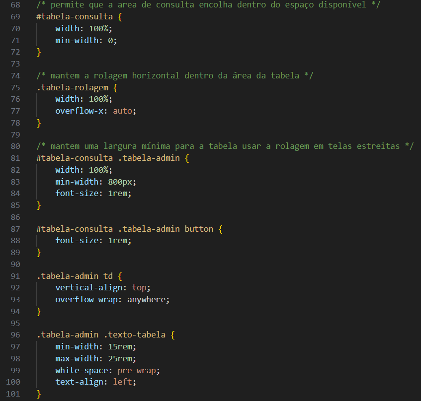

**Print da consulta em tela de celular:**

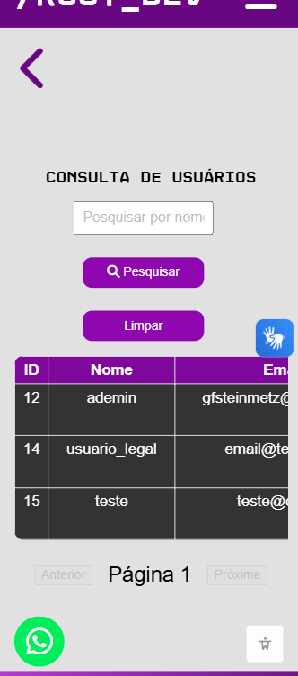
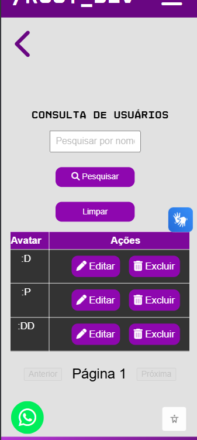

## Como manter as consultas

Em **private/admin/admin.js**, mantenha correspondência entre as colunas criadas e os índices utilizados para preenchê-las.

Se uma coluna for adicionada, atualize o cabeçalho, as células, os valores preenchidos e o **colspan** da mensagem de lista vazia.

Em **utils/paginacao.js**, **LIMITE_POR_PAGINA** define a quantidade exibida nas consultas administrativas.

Alterar esse valor afeta usuários, comentários e logs.

Os controllers devem continuar solicitando **limite + 1** registros, e **montarPagina** deve continuar limitando a lista enviada ao navegador e calculando **temProxima**.

Em **routes/admRoutes.js**, novas operações da página do admin precisam continuar utilizando **verificarAdmin**.

Operações que alteram registros devem manter a integração com **model/logModel.js** depois da confirmação da alteração.

As regras de validação e os relacionamentos do banco precisam acompanhar qualquer novo campo ou operação.