# Banco de dados

## Como o projeto armazena as informações

O ROOT DEV utiliza o MySQL para armazenar usuários, comentários, recuperações de senha e logs.

Os conteúdos das aulas ficam em arquivos Markdown no servidor. O banco guarda as informações dos comentários relacionados a essas aulas, mas não armazena o texto dos conteúdos didáticos.

As tabelas usadas pelo sistema são:

- **tb_usuarios:** guarda os dados das contas.
- **tb_comentarios:** guarda os comentários publicados nas aulas.
- **tb_recuperacoes:** guarda as solicitações de recuperação de senha.
- **tb_logs_acesso:** guarda os registros das ações acompanhadas pelo sistema.

As instruções para preparar o banco e cadastrar o 1º admin ficam no **README.md**.

## Comunicação entre o código e o banco

O arquivo **config/database.js** cria um pool de conexões com o MySQL.

Os arquivos da pasta **model** utilizam esse pool para executar as consultas. Cada model concentra as operações relacionadas à sua parte do sistema:

- **model/userModel.js:** cadastro, consulta, edição e exclusão de usuários.
- **model/comentarioModel.js:** publicação, consulta e exclusão de comentários.
- **model/recuperacaoModel.js:** criação, consulta e conclusão das recuperações de senha.
- **model/logModel.js:** registro e consulta dos logs.

O fluxo de uma solicitação funciona assim:

1. O navegador envia uma requisição por um formulário HTML ou por **fetch**.
2. A rota encaminha a requisição para o controller, passando pelos middlewares definidos.
3. O controller verifica os dados recebidos e as permissões necessárias.
4. Quando a operação exige uma preparação adicional, o controller utiliza um service antes de chamar o model.
5. O model executa o comando SQL pelo pool.
6. O banco devolve o resultado.
7. O resultado retorna por callback ao código que solicitou a operação.
8. O controller define a resposta enviada ao navegador.

Os services participam, por exemplo, da preparação dos hashes de senha e dos códigos de recuperação. Os models recebem esses valores preparados e executam as consultas.

O model não responde diretamente ao navegador. Ele recebe os dados necessários para a consulta e devolve um erro ou resultado.

As consultas utilizam a interface de callbacks do **mysql2**. A geração e a comparação de hashes também utilizam operações assíncronas, mas isso não transforma automaticamente as consultas SQL em Promises.

## Conexão com o MySQL

Em **config/database.js**, o projeto utiliza **mysql.createPool()**, da biblioteca **mysql2**.

Um pool administra um conjunto de conexões que podem ser reutilizadas pelas consultas. Assim, os models compartilham o acesso ao banco sem criar uma conexão própria a cada operação.

### Configurações recebidas do ambiente

As configurações são lidas pelas variáveis:

- **DB_HOST:** endereço onde o MySQL está funcionando.
- **DB_PORT:** porta utilizada pelo MySQL; quando não informada, utiliza **3306**.
- **DB_USER:** usuário do MySQL.
- **DB_PASSWORD:** senha desse usuário.
- **DB_NAME:** nome do banco utilizado pelo projeto.

O usuário informado nessa configuração é uma conta do MySQL. Ele não é o mesmo que o usuário cadastrado na tabela **tb_usuarios**.

O arquivo **index.js** carrega o **dotenv** antes de importar a configuração do banco, disponibilizando as variáveis do arquivo **.env** em **process.env**.

Em **config/database.js**, o código verifica se **DB_HOST**, **DB_USER**, **DB_PASSWORD** e **DB_NAME** foram definidas. Essa verificação identifica variáveis ausentes; a confirmação de que os valores permitem acessar o banco acontece na consulta inicial.

A porta é convertida em número e precisa ser um inteiro entre **1** e **65535**.

### Configurações do pool

Além dos dados de acesso, o pool utiliza:

```js
charset: "utf8mb4_unicode_ci",
waitForConnections: true,
connectionLimit: 10,
queueLimit: 100
```

Essas opções definem:

- **charset:** configuração de caracteres da comunicação com o MySQL.
- **waitForConnections:** permite aguardar uma conexão disponível quando todas estiverem ocupadas.
- **connectionLimit:** limita o pool a **10 conexões**.
- **queueLimit:** limita a **100** as solicitações que podem aguardar na fila do pool.

O limite de conexões não representa o número máximo de usuários cadastrados ou conectados ao site. As conexões são utilizadas pelas operações com o banco e podem ser reaproveitadas.

No final do arquivo, **module.exports = conexao** disponibiliza o pool para os models e para a verificação inicial do servidor.

### Verificação antes de iniciar o servidor

Criar o pool não confirma, sozinho, que o banco está acessível.

Em **index.js**, o sistema executa:

```js
conexao.query("SELECT 1", (erro) => {
```

Essa consulta verifica se a aplicação consegue acessar o MySQL com a configuração informada.

Quando funciona, o servidor carrega o cache dos conteúdos e executa **app.listen** para começar a receber requisições.

Quando falha, o código:

1. Mostra uma mensagem e o código do erro no terminal.
2. Solicita o encerramento do pool com **conexao.end**.
3. Define **process.exitCode = 1**.
4. Não executa **app.listen**.

Essa verificação evita iniciar o atendimento HTTP quando o acesso inicial ao banco não funciona. Falhas que ocorram depois da inicialização continuam sendo tratadas pelas operações que utilizam o banco.

**Print do código de conexão:**

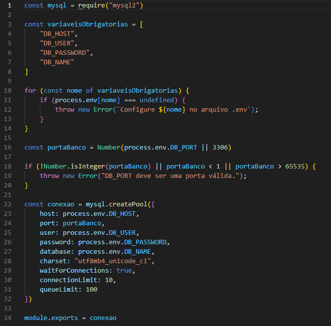

## Codificação dos textos

O arquivo **comandoSQL.sql** define o banco **mydb** com:

```sql
DEFAULT CHARACTER SET utf8mb4
COLLATE utf8mb4_unicode_ci
```

As quatro tabelas também utilizam essa configuração.

O conjunto de caracteres **utf8mb4** permite armazenar os caracteres Unicode utilizados pelo projeto, incluindo emojis.

A configuração precisa ser compatível entre a comunicação da aplicação e as tabelas do banco. Configurar somente a conexão não altera automaticamente uma tabela criada anteriormente com outra codificação.

A **collation** define regras de comparação e ordenação dos textos. Isso também influencia comparações realizadas nos campos de nome e e-mail e nas restrições de unicidade.

O suporte a emojis não remove os limites dos campos. O avatar continua sujeito às regras da aplicação e à capacidade da coluna.

A validação do JavaScript utiliza **length**, cuja contagem pode considerar alguns emojis como mais de uma unidade. Por isso, o limite de 10 não significa necessariamente 10 símbolos visíveis.

O arquivo **comandoSQL.sql** contém a estrutura utilizada para preparar o banco. Como utiliza **CREATE TABLE IF NOT EXISTS**, executá-lo novamente não atualiza automaticamente a definição das tabelas que já existem.

## Identificação e relacionamento dos registros

Cada tabela possui uma **chave primária**, que identifica seus registros:

- **user_id:** identifica o usuário.
- **com_id:** identifica o comentário.
- **rec_id:** identifica a recuperação.
- **log_id:** identifica o log.

Esses campos utilizam **AUTO_INCREMENT**. Isso faz o banco gerar o ID quando um registro é inserido.

Os IDs não representam a quantidade atual de registros. Se um registro for excluído, podem existir intervalos entre os números.

As tabelas de comentários, recuperações e logs também possuem uma **chave estrangeira**, que aponta para o usuário relacionado ao registro.

Uma chave estrangeira impede, por exemplo, que um comentário seja salvo com o ID de um usuário que não existe.

## Tabela tb_usuarios

A tabela **tb_usuarios** armazena as contas utilizadas no site.

Seus campos são:

- **user_id:** identificação do usuário, gerada automaticamente.
- **user_name:** nome utilizado no cadastro e no login.
- **user_email:** e-mail usado no cadastro, no login e na recuperação de senha.
- **user_pass:** hash da senha.
- **user_tipo:** identifica se a conta é **usuario** ou **admin**.
- **user_avatar:** representação textual escolhida para o avatar.

O nome permite até **80 caracteres**. O campo de e-mail comporta **255 caracteres**, mas a validação da aplicação limita a entrada a **254 caracteres**.

O avatar permite até **10 caracteres**, conforme a validação utilizada no projeto. Quando o usuário não informa um avatar, o código utiliza **:D**.

O campo **user_pass** comporta o hash produzido pelo bcrypt. A senha digitada não é salva diretamente nesse campo.

O campo **user_tipo** possui **usuario** como valor padrão. O cadastro público não permite que a pessoa escolha o tipo **admin**.

O telefone não faz parte da estrutura atual do cadastro.

### Nome e e-mail únicos

Na tabela **tb_usuarios**, os campos **user_name** e **user_email** possuem índices **UNIQUE**.

Isso impede que o banco aceite registros duplicados nesses campos.

O controller consulta a existência de outro usuário com os mesmos dados antes de salvar. Mesmo assim, a restrição no banco continua sendo necessária, pois protege os dados caso solicitações simultâneas tentem cadastrar o mesmo nome ou e-mail.

No arquivo **model/userModel.js**, a função **buscarUsuarioDuplicado(usuario, idIgnorado, callback)** recebe:

- **usuario:** objeto que contém o nome e o e-mail informados.
- **idIgnorado:** ID da conta que não deve ser considerada na busca.
- **callback:** função que receberá o erro ou o resultado.

Na edição, o ID ignorado é o da própria conta. Assim, manter o nome ou o e-mail atual não é considerado uma duplicação.

O trecho principal da consulta é:

```sql
WHERE (user_name = ? OR user_email = ?)
AND user_id <> ?
LIMIT 1
```

O símbolo **<>** significa diferente. Nesse caso, a consulta procura outra conta com o mesmo nome ou e-mail.

**Print da consulta de duplicidade:**

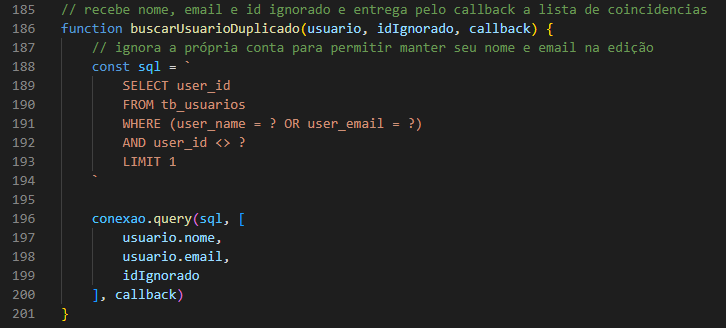

## Cadastro e armazenamento da senha

A preparação da senha acontece antes da consulta SQL.

Em **controller/userController.js**, o cadastro passa pela normalização, pelas validações e pela consulta de duplicidade.

Depois, o controller chama **criarUsuario**, de **service/usuarioService.js**.

O service gera o hash utilizando **gerarHash**, de **service/criptografiaService.js**:

```js
senhaHash = await gerarHash(usuario.senha)
```

A função compartilhada utiliza o bcrypt com custo de processamento **10**, definido por **RODADAS_HASH**.

Se a geração do hash falhar, o service entrega o erro ao callback e não solicita a inserção.

Quando funciona, prepara um objeto com:

- **nome**
- **email**
- **senhaHash**
- **avatar**

Esse objeto é enviado para **criarUsuario**, de **model/userModel.js**.

O model recebe o hash pronto e executa:

```sql
INSERT INTO tb_usuarios
    (user_name, user_email, user_pass, user_avatar)
VALUES (?, ?, ?, ?)
```

Os valores enviados são o nome, o e-mail, o hash da senha e o avatar.

A senha original não é encaminhada ao model para gravação. A confirmação da senha também não é armazenada.

O **user_id** não aparece no comando porque é gerado pelo banco. O **user_tipo** utiliza o valor padrão **usuario**, definido na tabela.

No login, **service/autenticacaoService.js** utiliza **compararHash**, de **service/criptografiaService.js**, para conferir a senha recebida com o hash armazenado.

Essa comparação não recupera a senha original.

**Print do cadastro no banco:**

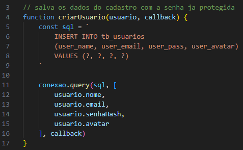

## Tabela tb_comentarios

A tabela **tb_comentarios** armazena os comentários publicados nas aulas.

Seus campos são:

- **com_id:** identificação do comentário, gerada automaticamente.
- **com_user_id:** ID do usuário que publicou o comentário.
- **com_texto:** texto do comentário, limitado a **1000 caracteres**.
- **com_data:** data e hora da publicação.
- **com_topico:** identificação do tópico, com capacidade de **50 caracteres**.
- **com_categoria:** identificação da categoria, com capacidade de **20 caracteres**.

O campo **com_data** utiliza **DEFAULT CURRENT_TIMESTAMP**. Quando o comentário é inserido sem informar uma data, o banco registra o momento da inserção.

O campo **com_user_id** aponta para **user_id**, da tabela **tb_usuarios**.

### Relação dos comentários com as aulas

As categorias e os tópicos das aulas ficam organizados nos arquivos Markdown. Por isso, **com_categoria** e **com_topico** não possuem chaves estrangeiras apontando para outra tabela.

No arquivo **controller/comentarioController.js**, a função **salvarComentario()** verifica a categoria, o tópico e a existência do arquivo da aula antes de chamar o model.

Essa verificação é responsabilidade do back-end, pois o MySQL não verifica a existência de arquivos Markdown.

No arquivo **model/comentarioModel.js**, a função **salvarComentario()** recebe os dados já verificados e executa a inserção.

O ID do autor deve vir da sessão autenticada. Ele não deve ser escolhido livremente pelos dados enviados no formulário.

**Print da inserção de comentários:**

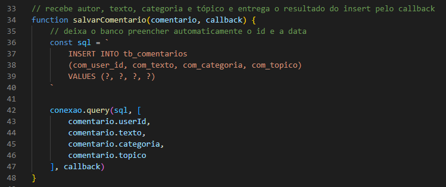

### Alterações nos arquivos das aulas

Renomear ou excluir um arquivo Markdown não altera automaticamente os comentários existentes.

Os comentários continuam armazenados com os valores antigos de **com_categoria** e **com_topico**.

Se uma aula for renomeada ou movida, é necessário avaliar esses registros para manter a ligação correta entre a aula e seus comentários.

## Tabela tb_recuperacoes

A tabela **tb_recuperacoes** armazena as solicitações de recuperação de senha.

Seus campos são:

- **rec_id:** identificação da solicitação, gerada automaticamente.
- **tb_usuarios_user_id:** ID da conta que solicitou a recuperação.
- **rec_codigo:** hash do código enviado por e-mail.
- **rec_expiracao:** data e hora em que a solicitação deixa de ser válida.
- **rec_usado:** informa se a recuperação já foi utilizada.

O campo **rec_codigo** possui capacidade de **255 caracteres** para armazenar o hash. O código recebido por e-mail possui **8 caracteres**, mas não é salvo diretamente no banco.

O campo **rec_usado** começa com **0**. Depois que a recuperação é concluída, ele passa para **1**.

Ter **rec_usado = 0** não garante, sozinho, que uma solicitação possa ser utilizada. Ela também precisa estar dentro do prazo e atender às demais verificações do sistema.

### Criação da recuperação

Em **service/recuperacaoService.js**, **criarRecuperacao(recuperacao, callback)** recebe o ID do usuário e o código gerado pelo sistema.

O service utiliza **gerarHash**, de **service/criptografiaService.js**, para produzir o hash do código.

Se essa etapa falhar, entrega o erro ao callback e não chama o model.

Quando funciona, prepara:

```js
const dadosRecuperacao = {
    userId: recuperacao.userId,
    codigoHash
}
```

Depois, chama **criarRecuperacao**, de **model/recuperacaoModel.js**.

O model recebe o hash pronto e executa:

```sql
INSERT INTO tb_recuperacoes
    (tb_usuarios_user_id, rec_codigo, rec_expiracao)
VALUES (?, ?, DATE_ADD(NOW(), INTERVAL 10 MINUTE))
```

O código original é utilizado no envio do e-mail. No banco, **rec_codigo** recebe somente seu hash.

A data de expiração é calculada no SQL:

```sql
DATE_ADD(NOW(), INTERVAL 10 MINUTE)
```

Nesse trecho:

- **NOW()** representa a data e a hora atuais do banco.
- **INTERVAL 10 MINUTE** representa o prazo de **10 minutos**.
- **DATE_ADD()** soma esse prazo ao momento atual.

O campo **rec_usado** utiliza o valor padrão **0**, definido na tabela.

O cálculo do prazo utiliza o relógio do MySQL, que também será utilizado nas verificações de validade.

**Print da criação da recuperação:**

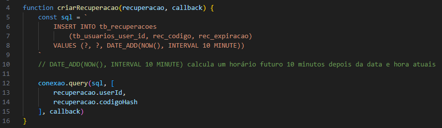

### Consulta da recuperação mais recente

Em **model/recuperacaoModel.js**, **buscarUltimaRecuperacao(userId, callback)** consulta a solicitação mais recente da conta.

A consulta utiliza:

```sql
ORDER BY rec_id DESC
LIMIT 1
```

O **DESC** organiza os IDs do maior para o menor. O **LIMIT 1** faz a consulta devolver apenas o registro com o maior ID daquele usuário.

Além dos dados necessários para verificar o código, a consulta calcula:

```sql
(rec_expiracao > NOW()) AS rec_valida
```

**rec_valida** informa se o prazo ainda está aberto conforme a data e a hora do MySQL.

Esse resultado é utilizado pelo controller junto com a verificação de **rec_usado** e a comparação do código recebido com o hash armazenado.

A consulta procura primeiro a solicitação mais recente. Ela não procura uma solicitação antiga que ainda possa estar dentro do prazo.

Por isso, criar uma nova recuperação impede o uso da anterior pelo fluxo do sistema, mesmo que o registro antigo ainda tenha **rec_usado = 0**.

Os registros antigos não são apagados automaticamente apenas porque o prazo terminou.

### Alteração da senha e uso da recuperação

Em **service/recuperacaoService.js**, **concluirRecuperacao(recuperacao, novaSenha, callback)** gera o hash da nova senha utilizando **gerarHash**.

Se a geração falhar, o service devolve o erro sem solicitar a atualização no banco.

Quando funciona, chama:

```js
recuperacaoModel.concluirRecuperacao(recuperacao, senhaHash, callback)
```

Em **model/recuperacaoModel.js**, a função recebe os dados da recuperação autorizada e o hash já preparado.

O comando **UPDATE** altera as tabelas **tb_usuarios** e **tb_recuperacoes** na mesma operação.

A consulta:

- Atualiza **user_pass** com o novo hash.
- Altera **rec_usado** para **1**.
- Confere o ID do usuário, o e-mail e o ID da recuperação.
- Exige **rec_usado = 0**.
- Exige que **rec_expiracao** seja maior que **NOW()**.
- Exige que não exista uma solicitação mais recente para a conta.

O **INNER JOIN** relaciona o usuário à recuperação.

O **LEFT JOIN** procura uma recuperação do mesmo usuário com ID maior. A condição **mais_recente.rec_id IS NULL** exige que essa recuperação posterior não exista.

As condições são verificadas novamente no momento da atualização. Assim, uma recuperação que tenha expirado, sido utilizada ou sido substituída depois da verificação do código não autoriza a alteração da senha.

Atualizar a senha e marcar a recuperação como utilizada no mesmo comando evita realizar essas duas mudanças separadamente.

Se **affectedRows** for **0**, nenhuma atualização foi realizada. O controller trata esse resultado como uma recuperação que não pode mais ser concluída.

**Print da conclusão da recuperação:**

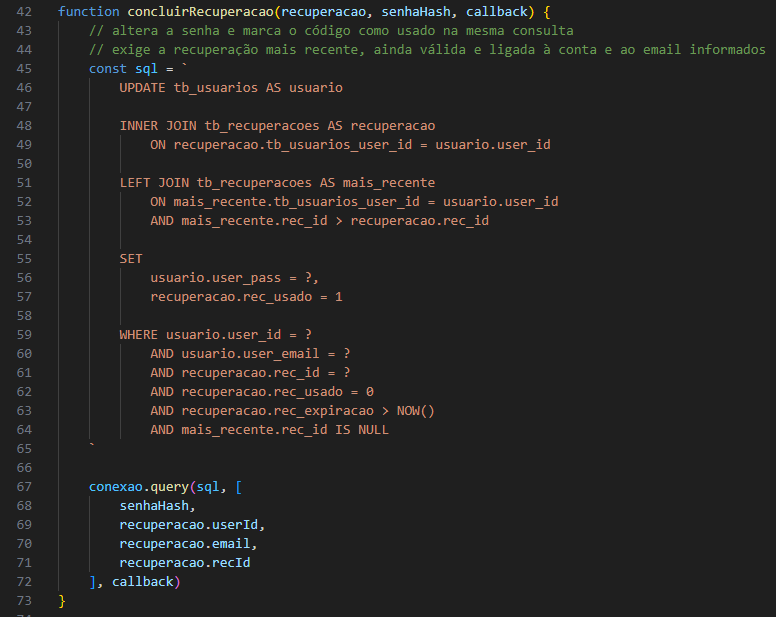

## Tabela tb_logs_acesso

A tabela **tb_logs_acesso** armazena os registros das ações acompanhadas pelo sistema.

Seus campos são:

- **log_id:** identificação do log, gerada automaticamente.
- **tb_usuarios_user_id:** ID do usuário relacionado à ação, quando houver.
- **log_acao:** descrição da ação, com capacidade de **100 caracteres**.
- **log_data:** data e hora do registro.

O campo **log_data** utiliza **DEFAULT CURRENT_TIMESTAMP**, portanto a data é preenchida automaticamente pelo banco.

O campo **tb_usuarios_user_id** aceita **NULL**. Isso permite manter registros sem vínculo com uma conta existente.

No arquivo **model/logModel.js**, a função **registrarLog()** recebe um objeto com **userId** e **acao**, além da callback.

O comando insere apenas o vínculo com o usuário e a descrição. O ID do log e sua data são preenchidos pelo banco.

A gravação de logs depende das chamadas feitas pelo back-end. A tabela não registra automaticamente toda alteração realizada no banco.

**Print do registro de logs:**

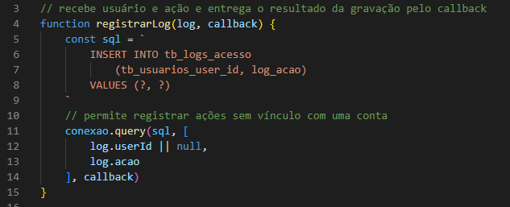

### Nome do usuário nos relatórios

A tabela **tb_logs_acesso** não guarda uma cópia do nome do usuário.

No arquivo **model/logModel.js**, a função **buscarTodosLogs()** consulta o nome atual na tabela **tb_usuarios**.

Por isso, quando uma pessoa altera seu nome, os logs vinculados à conta passam a mostrar esse nome atualizado.

Se a conta for excluída, o vínculo passa a ser **NULL** e o registro do log continua existindo.

A página do admin permite consultar esses registros. O projeto não oferece botões para editar ou excluir logs nessa página.

## Relacionamentos e exclusão de usuários

A tabela **tb_usuarios** possui relacionamentos **1:N** com as demais tabelas.

Isso significa que:

- Um usuário pode publicar vários comentários.
- Um usuário pode solicitar várias recuperações de senha.
- Um usuário pode estar relacionado a vários logs.

As regras de exclusão foram definidas nas chaves estrangeiras.

### Comentários com ON DELETE CASCADE

Na tabela **tb_comentarios**, a chave estrangeira de **com_user_id** utiliza **ON DELETE CASCADE**.

Quando uma conta é excluída, o banco também exclui os comentários dessa conta.

Essa regra funciona a partir da exclusão do usuário. Excluir um comentário não exclui seu autor.

### Recuperações com ON DELETE CASCADE

Na tabela **tb_recuperacoes**, a chave estrangeira de **tb_usuarios_user_id** também utiliza **ON DELETE CASCADE**.

Quando a conta é excluída, suas solicitações de recuperação são removidas pelo banco.

### Logs com ON DELETE SET NULL

Na tabela **tb_logs_acesso**, a chave estrangeira utiliza **ON DELETE SET NULL**.

Quando uma conta é excluída:

- O log permanece no banco.
- A descrição da ação permanece.
- A data permanece.
- O campo **tb_usuarios_user_id** passa a ser **NULL**.

Essa regra exige que o campo aceite **NULL**.

No arquivo **model/userModel.js**, a função **excluirUsuario()** executa a exclusão da conta. O próprio banco aplica as regras das chaves estrangeiras aos registros relacionados.

Essas regras também se aplicam quando a exclusão do usuário é executada diretamente no MySQL.

**Print dos relacionamentos no MER:**

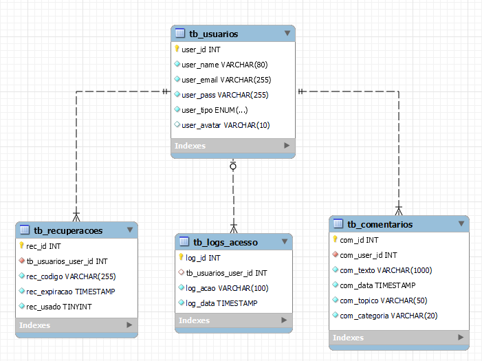

**Print das regras de exclusão:**

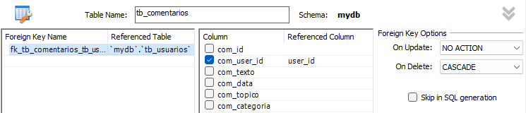
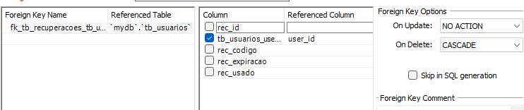
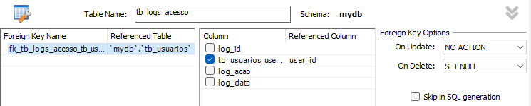

## Como os valores são enviados nas consultas

No arquivo **model/userModel.js**, a função **criarUsuario()** utiliza **?** no comando SQL e envia os valores separadamente para **conexao.query()**.

O mesmo padrão aparece nos outros models.

Exemplo:

```js
conexao.query(sql, [
    usuario.nome,
    usuario.email,
    usuario.senhaHash,
    usuario.avatar
], callback)
```

Cada valor ocupa o lugar do **?** correspondente, seguindo a ordem do array.

Isso evita montar o comando SQL colocando diretamente o texto digitado pelo usuário dentro da consulta.

A biblioteca mysql2 trata os valores recebidos. As verificações do controller continuam necessárias para conferir tamanho, formato, permissões e outras regras do sistema.

A callback recebe o erro ou o resultado da operação:

- Nas consultas **SELECT**, o resultado normalmente contém os registros encontrados.
- Nas operações **INSERT**, o resultado pode informar o ID criado em **insertId**.
- Nas operações **UPDATE** e **DELETE**, o resultado fornece informações como **affectedRows**.

Algumas funções do model devolvem todos os registros encontrados. Outras utilizam a posição **[0]** para devolver apenas o registro esperado.

## Consultas que combinam tabelas

No arquivo **model/comentarioModel.js**, a função **buscarPorTopico()** combina comentários com os dados dos autores usando **INNER JOIN**.

Assim, a consulta consegue devolver o texto, a data, o nome e o avatar utilizados na exibição dos comentários.

No arquivo **model/logModel.js**, a função **buscarTodosLogs()** utiliza **LEFT JOIN**.

Essa diferença é necessária porque um log pode continuar existindo sem um usuário associado. O **LEFT JOIN** mantém o log no resultado mesmo quando não encontra uma conta correspondente.

**Print da consulta de logs com usuários:**

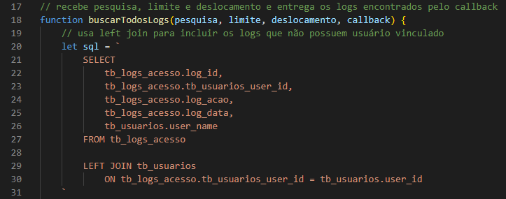

## Pesquisa e paginação

No arquivo **model/userModel.js**, a função **buscarTodosUsuarios()** recebe:

- **pesquisa:** texto usado para filtrar os registros.
- **limite:** quantidade máxima de registros que a consulta deve retornar.
- **deslocamento:** quantidade de registros que devem ser pulados.
- **callback:** função que receberá o resultado.

As consultas de comentários e logs seguem um padrão semelhante.

### Pesquisa com LIKE

No arquivo **model/userModel.js**, a função **buscarTodosUsuarios()** utiliza **LIKE** para procurar o texto informado em campos como nome e e-mail.

O termo de pesquisa recebe **%** antes e depois.

Por exemplo, **%ana%** permite encontrar valores que contenham **ana** em alguma parte do texto.

Para pesquisar IDs como texto, a consulta utiliza **CAST(... AS CHAR)**.

Os valores da pesquisa continuam sendo enviados separadamente pelos **?**.

### Limite e deslocamento

Em **utils/paginacao.js**, **lerConsulta(query)** prepara os parâmetros utilizados pelas consultas administrativas.

Quando não são informados, a pesquisa recebe texto vazio e a página recebe **1**.

A função verifica se:

- A pesquisa é um texto.
- A página recebida é um texto formado somente por dígitos.
- O número da página é um inteiro seguro maior ou igual a **1**.
- O deslocamento calculado também é um inteiro seguro.

Se os parâmetros forem inválidos, retorna **null**, permitindo que o controller recuse a consulta.

O limite é definido por:

```js
const LIMITE_POR_PAGINA = 10
```

O deslocamento é calculado com:

```js
const deslocamento = (pagina - 1) * LIMITE_POR_PAGINA
```

Com **10 registros por página**:

- A página **1** começa no deslocamento **0**.
- A página **2** começa no deslocamento **10**.
- A página **3** começa no deslocamento **20**.

O controller solicita ao model um registro além do limite, ou seja, até **11 registros**.

O model aplica:

```sql
LIMIT ? OFFSET ?
```

Depois da consulta, **montarPagina(nomeCampo, registros, consulta)**, de **utils/paginacao.js**, organiza a resposta com:

- A lista limitada aos primeiros **10 registros**.
- O número da página consultada.
- **temProxima**, indicando se a consulta encontrou o registro adicional.

O registro adicional é utilizado apenas para identificar a existência de uma próxima página. Ele não é incluído na lista enviada ao navegador.

O **ORDER BY** define a ordem dos resultados antes da aplicação do limite.

Essa preparação é compartilhada pelas consultas administrativas de usuários, comentários e logs.

**Print da pesquisa e paginação no model:**

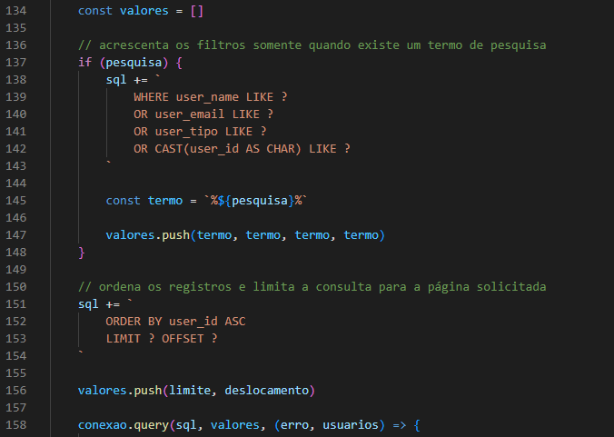

## Cuidados ao alterar a estrutura

O MER, o banco utilizado e o código precisam representar a mesma estrutura.

Alterar o MER não modifica automaticamente um banco que já está em uso. Da mesma forma, alterar uma tabela diretamente no MySQL não atualiza o MER.

Ao adicionar ou modificar um campo:

1. Atualize sua definição no MER.
2. Aplique a mudança no banco utilizado pelo projeto, preservando os dados necessários.
3. Revise os comandos SQL dos models que utilizam a tabela.
4. Atualize as validações dos controllers.
5. Ajuste os formulários e scripts quando o campo aparecer na interface.
6. Atualize a documentação relacionada.

Não é necessário recriar o banco inteiro para cada alteração. Recriar tabelas pode apagar dados existentes.

Os nomes das colunas precisam ser respeitados exatamente como estão definidos. Por exemplo:

- Comentários utilizam **com_user_id**.
- Recuperações utilizam **tb_usuarios_user_id**.
- Logs utilizam **tb_usuarios_user_id**.

Embora esses campos apontem para **tb_usuarios.user_id**, seus nomes são diferentes.

Os prints de código indicados neste documento usam a versão analisada do projeto. Se novas alterações mudarem as linhas, localize a função informada e enquadre o mesmo trecho.