# Estruturas globais e recursos compartilhados

Este documento explica a organização do ROOT DEV e as partes utilizadas por várias páginas, como a inicialização do servidor, a sessão, o header, o footer e os scripts compartilhados.

Os caminhos começam na pasta principal do projeto, onde está **index.js**. As linhas indicadas para os prints consideram os arquivos comentados utilizados nesta documentação. Se o código mudar, use também o nome da função para localizar o trecho.

## Organização do projeto

Cada pasta possui uma responsabilidade:

- **public:** guarda as páginas, os scripts, as imagens e os estilos disponibilizados ao navegador.
- **private/admin:** guarda o HTML e o JavaScript da página do admin, enviados por rotas protegidas.
- **routes:** define as rotas e as funções que atendem cada requisição.
- **controller:** recebe as requisições, verifica os dados e organiza as operações.
- **model:** executa as consultas e alterações no banco.
- **config:** configura o banco de dados e o envio de e-mail.
- **middleware:** verifica o acesso administrativo e trata erros e sua apresentação ao navegador.
- **validacoes:** reúne regras reutilizadas para conferir os dados dos usuários.
- **service:** reúne autenticação, criptografia, preparação do cadastro, recuperação de senha e envio de e-mail.
- **utils:** contém funções compartilhadas de normalização dos dados, paginação e gerenciamento de sessões.
- **content:** guarda as aulas Markdown, separadas por categoria.
- **Doc:** reúne os documentos que explicam o projeto.

O código utiliza funções e módulos. As funções são distribuídas conforme sua responsabilidade, sem a necessidade de criar classes JavaScript.

## Como os arquivos compartilham funções

No servidor, os arquivos utilizam **require** para carregar funções disponibilizadas por **module.exports**.

Em **controller/userController.js**, por exemplo, são carregados os serviços e utilitários utilizados nas operações:

```js
const usuarioService = require("../service/usuarioService")
const autenticacaoService = require("../service/autenticacaoService")

const { encerrarSessao, iniciarSessao } = require("../utils/sessao")
const { normalizarUsuario } = require("../utils/normalizarUsuario")
```

Cada função continua definida no arquivo responsável por ela. O controller utiliza essas funções para organizar a operação.

Os principais recursos compartilhados são:

- **service/usuarioService.js:** gera o hash da senha e prepara os dados enviados ao model no cadastro.
- **service/autenticacaoService.js:** localiza a conta, compara a senha e verifica a exigência de acesso administrativo.
- **service/criptografiaService.js:** disponibiliza **gerarHash** e **compararHash**, utilizando bcrypt com custo 10 para a geração.
- **service/recuperacaoService.js:** prepara os hashes do código de recuperação e da nova senha.
- **service/emailService.js:** monta e envia o e-mail de recuperação.
- **utils/normalizarUsuario.js:** devolve um novo objeto com nome, e-mail e avatar preparados, preservando a senha.
- **utils/paginacao.js:** valida os parâmetros de consulta, calcula o deslocamento e monta a resposta paginada.
- **utils/sessao.js:** cria e encerra sessões.

Os models executam as consultas no banco. Os serviços de cadastro e recuperação entregam aos models os hashes já preparados.

No navegador, **public/scripts/sessao-cliente.js** utiliza **export** e é carregado por **import()**. Esse módulo compartilha a consulta do estado de login entre os scripts da mesma página.

## Como o servidor é preparado

Em **index.js**, a primeira instrução carrega as configurações:

```js
require("dotenv").config()
```

O dotenv disponibiliza os valores do arquivo **.env** em **process.env**. Essa chamada aparece antes dos módulos que dependem dessas informações, incluindo as configurações do banco e do e-mail.

Depois, o arquivo carrega Express, express-session, os middlewares, a conexão com o banco, as rotas e o controller de conteúdo.

A aplicação e a porta são definidas assim:

```js
const app = express()
const port = Number(process.env.PORT || 8000)
```

**express()** cria a aplicação. **PORT** define a porta HTTP; quando não informada, o código utiliza **8000**.

O servidor verifica se a porta é um número inteiro entre 1 e 65535. Também exige a configuração de **SESSION_SECRET**, utilizada para assinar o identificador da sessão.

As configurações do banco vêm de **DB_HOST**, **DB_PORT**, **DB_USER**, **DB_PASSWORD** e **DB_NAME**. A conexão utiliza um pool, configurado em **config/database.js**.

A inicialização pelo terminal é feita com **npm start**. O terminal deve permanecer aberto enquanto o sistema estiver em uso.

## Como os dados enviados são lidos

Em **index.js**, estas instruções preparam a leitura dos corpos das requisições:

```js
app.use(express.urlencoded({ extended: true }))
app.use(express.json())
```

**express.urlencoded** lê os dados enviados por formulários HTML. No cadastro, por exemplo, os campos são enviados pelo formulário para o servidor.

**express.json** lê os dados enviados em JSON pelos scripts, como acontece na edição de perfil e na publicação de comentários.

Depois dessa leitura, os controllers acessam os valores por **req.body**.

Essas configurações aparecem antes das rotas, pois os dados precisam estar disponíveis quando as funções dos controllers forem executadas.

## Como os arquivos públicos são disponibilizados

Em **index.js**, a pasta pública é configurada com:

```js
app.use(express.static(path.join(__dirname, 'public')))
```

**path.join** monta o caminho da pasta. **__dirname** representa a pasta onde está **index.js**.

**express.static** permite acessar os arquivos de **public** pelo navegador. O nome da pasta não faz parte do link:

- **public/cadastro.html** é acessado por **/cadastro.html**.
- **public/scripts/perfil.js** é acessado por **/scripts/perfil.js**.
- **public/styles/global.css** é acessado por **/styles/global.css**.

Os arquivos de **private/admin** não são disponibilizados por essa configuração. Eles são enviados pelas rotas protegidas do admin.

**Print da preparação do servidor:**

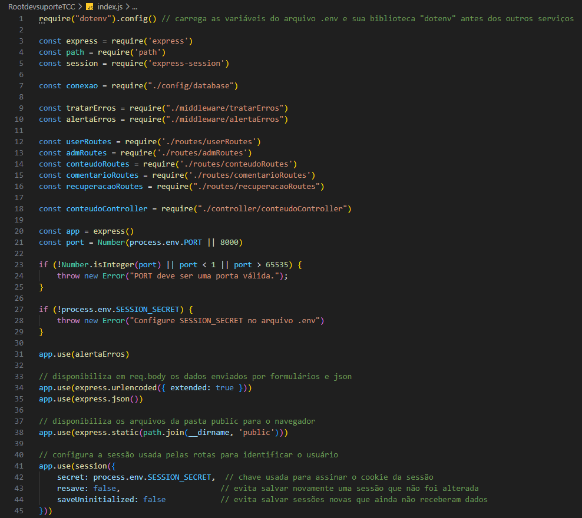

## Como as rotas são separadas

A página inicial é entregue pelo **express.static**, que disponibiliza **public/index.html** no endereço **/**. Não existe uma rota adicional necessária para enviar esse mesmo arquivo.

Depois das rotas, **app.use(tratarErros)** registra o middleware global responsável pelos erros encaminhados com **next(erro)**.

Antes de executar **app.listen**, o servidor testa a conexão com o banco por meio de **SELECT 1**.

Se a consulta falhar, registra o problema no terminal, encerra o pool e define um código de saída de erro. O servidor HTTP não é iniciado.

Se a consulta funcionar, chama **carregarCacheConteudos()** para preparar as aulas válidas na memória. Esse cache é utilizado pelo menu de tópicos, pela abertura das aulas e pela pesquisa.

Somente depois dessas etapas, **app.listen** começa a atender na porta configurada.

**Print do encaminhamento das rotas e da inicialização:**

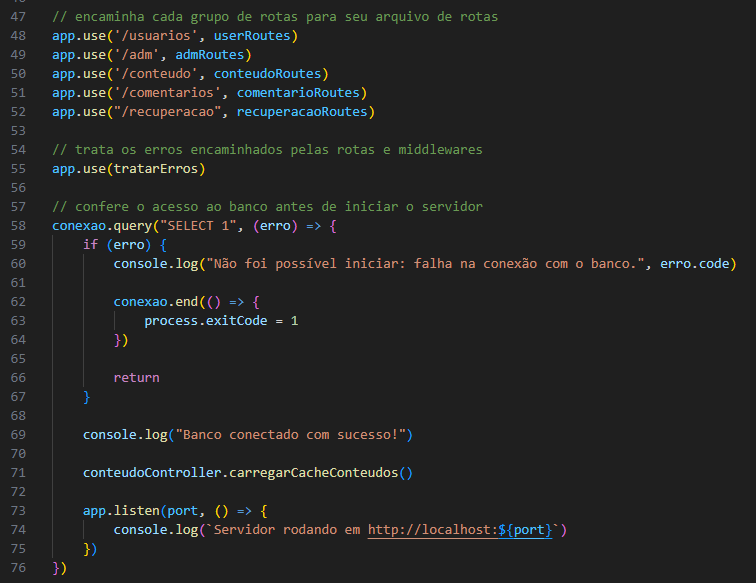

## Como uma operação percorre os arquivos

## Como uma operação percorre os arquivos

A edição de perfil mostra como as partes do projeto trabalham juntas.

Em **public/scripts/perfil.js**, **salvarPerfil(evento)** impede o envio comum do formulário, lê os campos e envia uma requisição **PATCH /usuarios/perfil**, com os dados em JSON.

Em **routes/userRoutes.js**, a rota aplica o limite de tentativas e encaminha a requisição para **atualizarPerfil**, de **controller/userController.js**.

O controller identifica a conta pela sessão. Utiliza **normalizarUsuario** para preparar nome, e-mail e avatar e, depois, verifica as regras em **validarDadosUsuario**.

A senha atual é comparada com o hash armazenado utilizando **compararHash**, do serviço de criptografia. O controller também verifica se o nome ou o e-mail pertence a outra conta.

Se as verificações permitirem continuar, **model/userModel.js** executa o UPDATE com os valores enviados por parâmetros.

O model entrega o resultado pelo callback. O controller atualiza os dados da sessão, registra a ação e responde ao navegador em JSON.

O script mostra o resultado em um alerta. Após o sucesso, emite o evento **perfil-atualizado**, utilizado pela navegação para consultar novamente a sessão.

Nesse fluxo:

- O HTML contém os campos.
- O script prepara e envia a requisição.
- A rota aplica o limite e encaminha a operação.
- O controller organiza as verificações.
- Os utilitários e serviços executam as tarefas compartilhadas.
- O model executa o SQL.
- O controller envia a resposta.
- O script apresenta o resultado e avisa a navegação sobre a alteração.

Os detalhes estão em **DOC_PERFIL.md**.

## Informações recebidas pelas funções do servidor

Em **controller/userController.js**, **controller/admController.js** e nos demais controllers, os dados podem vir de locais diferentes:

- **req.body:** corpo da requisição, como nome, e-mail e senha.
- **req.params:** partes variáveis da rota, como o id em **/usuarios/:id**.
- **req.query:** valores depois de **?**, como pesquisa e página.
- **req.session:** informações da sessão mantida pelo servidor.
- **res:** objeto utilizado para responder ao navegador.

Middlewares e controllers também podem receber **next** como terceiro parâmetro.

**next()**, sem um erro, continua o fluxo normal para a próxima função.

**next(erro)** encaminha a falha ao tratamento de erros do Express. Os controllers que utilizam essa chamada precisam declarar **next** em seus parâmetros.

Quando uma função envia uma resposta e encerra a operação, deve interromper sua execução para evitar outra resposta ou a continuação indevida do processamento.

## Como a sessão identifica o usuário

Em **index.js**, a configuração de **express-session** permite manter informações entre as requisições.

As opções utilizadas são:

- **secret:** chave utilizada para assinar o identificador da sessão.
- **resave: false:** evita salvar novamente uma sessão que não foi alterada.
- **saveUninitialized: false:** evita salvar uma sessão nova que ainda não recebeu dados.

O navegador recebe o cookie **connect.sid**, que identifica a sessão. Os dados de **req.session.usuario** ficam no servidor.

Em **service/autenticacaoService.js**, **autenticar** confirma as credenciais e prepara os dados da conta para a sessão, com esta correspondência:

```js
req.session.usuario = {
    id: usuario.user_id,
    nome: usuario.user_name,
    tipo: usuario.user_tipo,
    avatar: usuario.user_avatar
}
```

O controller recebe esses dados em **resultado.usuario** e chama **iniciarSessao**, de **utils/sessao.js**.

Essa função executa **req.session.regenerate** para criar um novo identificador e uma nova sessão. Depois, atribui o usuário a **req.session.usuario** e executa **req.session.save**.

O callback informa quando a sessão foi salva. O controller só continua para o registro do login e o redirecionamento após essa confirmação.

Isso evita redirecionar a página antes de os dados da sessão estarem disponíveis. Se a criação ou a gravação falhar, o erro é encaminhado ao tratamento global.

Para sair, **encerrarSessao** executa **req.session.destroy** e solicita a remoção do cookie **connect.sid**.

A configuração atual não define um armazenamento externo para as sessões. Elas ficam na memória do servidor e deixam de estar disponíveis quando ele é reiniciado.

## Como os dados da sessão são atualizados

Em **controller/userController.js**, **verificarSessao(req, res)** consulta os dados atuais da conta no banco.

Se não existir sessão, retorna **logado: false**.

Se existir, consulta a conta pelo id. Quando a conta é encontrada, atualiza nome, tipo e avatar na sessão e devolve **logado: true**, junto com os dados do usuário.

Isso permite mostrar alterações de nome ou avatar sem exigir outro login.

A função também usa:

```js
res.set("Cache-Control", "no-store")
```

Esse cabeçalho pede ao navegador que não armazene a resposta para reutilizá-la depois. A consulta deve refletir o estado atual.

Se a conta não existir mais, a função encerra a sessão e informa que não há usuário conectado.

**Print da atualização da sessão:**

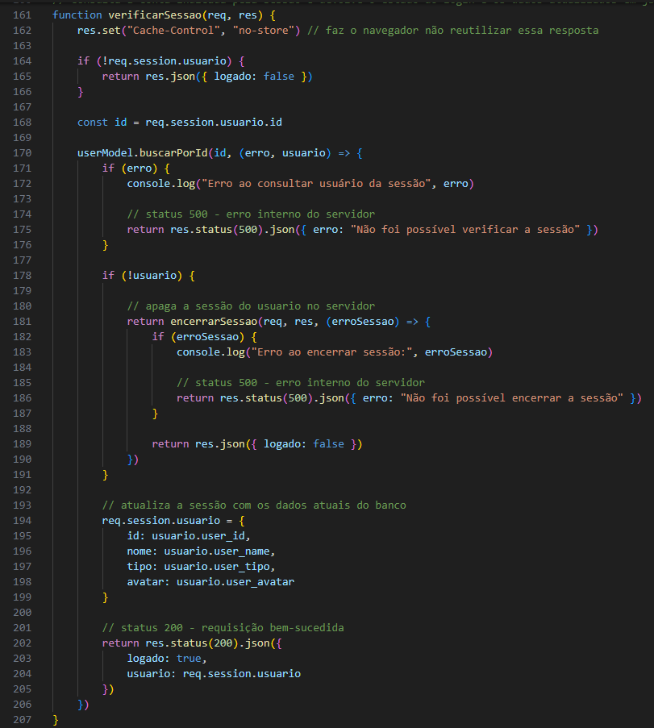

## Como a consulta da sessão é compartilhada no navegador

Em **public/scripts/sessao-cliente.js**, a variável **consultaSessao** guarda a Promise da consulta ao servidor.

A função **consultarSessao(atualizar = false)** inicia uma consulta quando ainda não existe uma guardada. As próximas chamadas aproveitam a mesma operação ou seu resultado.

Isso permite que a navegação e a verificação de login dos comentários utilizem uma única requisição a **GET /usuarios/sessao** durante o carregamento da página.

O módulo é carregado com:

```js
const { consultarSessao } = await import("/scripts/sessao-cliente.js")
const dados = await consultarSessao()
```

Para buscar dados novos, utiliza-se:

```js
const dados = await consultarSessao(true)
```

A atualização forçada é necessária depois de alterações que afetem os dados apresentados na navegação.

O fetch utiliza **cache: "no-store"** e solicita JSON pelo cabeçalho **Accept**. Isso controla o cache HTTP do navegador. A variável do módulo é um armazenamento separado, mantido pelo próprio JavaScript enquanto a página estiver aberta.

Se uma consulta falhar, ela é removida da variável para permitir uma nova tentativa. A comparação com a consulta atual evita que uma falha antiga apague uma consulta mais recente.

Recarregar a página reinicia esse estado. O compartilhamento ocorre entre os scripts da mesma página, não entre abas diferentes.

## Como o header funciona

Em **public/index.html**, o header contém a marca, os botões Login e Cadastro e a estrutura do menu para telas menores.

Os principais ids utilizados pelos scripts são:

- **auth-buttons:** área dos controles de autenticação.
- **nav-drawer-menu:** conteúdo do menu compacto.
- **menu-icon:** ícone utilizado para abrir e fechar esse menu.

Essa estrutura aparece nas outras páginas. O projeto não utiliza uma função que gere automaticamente o header de todos os HTMLs.

Por isso, ao alterar um link ou controle compartilhado, é necessário atualizar as páginas que possuem essa estrutura.

**Print da estrutura do header:**

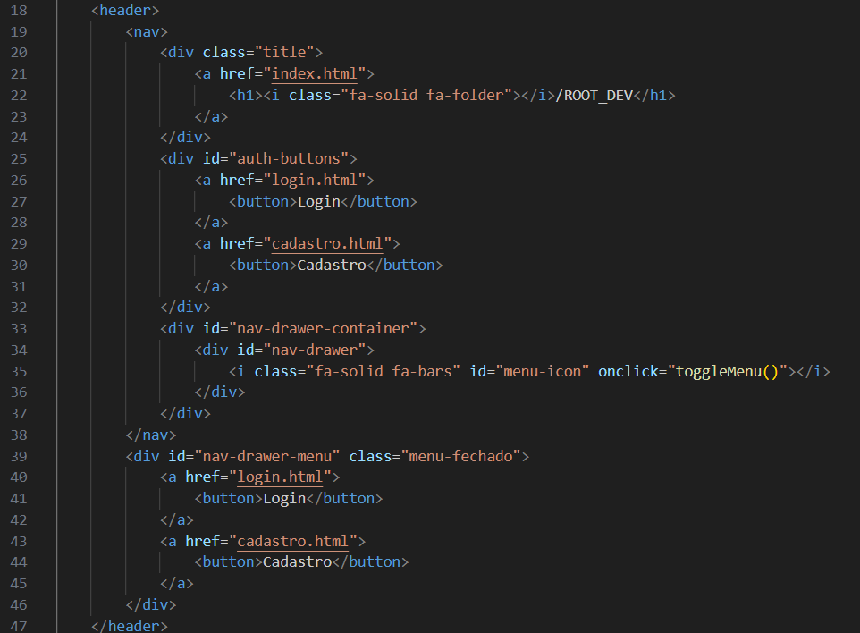

## Como o header muda depois do login

Em **public/scripts/navbar-auth.js**, **verificarLogin(atualizar = false)** utiliza o módulo compartilhado de sessão:

```js
const { consultarSessao } = await import("/scripts/sessao-cliente.js")
const dados = await consultarSessao(atualizar)
```

Se **dados.logado** for falso durante o carregamento, mantém os controles iniciais de visitante.

Se for verdadeiro, monta os controles da conta conectada nos menus normal e compacto:

- **Meu Perfil:** abre **/perfil.html**.
- **Sair:** envia **POST /usuarios/logout**.
- Avatar: mostra o texto salvo na conta.

Os controles repetidos utilizam classes, como **avatar-usuario** e **sair**. Os IDs **user-painel** e **menu-avatar-usuario** identificam áreas diferentes.

A estrutura é inserida com **innerHTML**, mas o avatar recebido do servidor é preenchido separadamente com **innerText**:

```js
authButtons.querySelector(".avatar").innerText = dados.usuario.avatar || ":D"
navDrawerMenu.querySelector(".avatar").innerText = dados.usuario.avatar || ":D"
```

O valor **:D** é utilizado quando não existe um avatar aproveitável.

O arquivo também registra um ouvinte:

```js
document.addEventListener("perfil-atualizado", () => {
    verificarLogin(true)
})
```

Depois de salvar uma edição, os scripts de perfil e do painel emitem:

```js
document.dispatchEvent(new Event("perfil-atualizado"))
```

Esse evento inicia uma nova consulta da sessão e atualiza os avatares. A edição já foi confirmada pelo servidor; a atualização visual é concluída de forma assíncrona.

Todo o código de **navbar-auth.js** fica dentro de uma função executada imediatamente. Isso mantém **verificarLogin** em um escopo próprio, sem exigir que outros arquivos chamem essa função diretamente.

O ouvinte mantém acesso à função porque foi definido dentro do mesmo escopo.

A navegação apenas apresenta o estado do login. Ela não autentica a conta nem substitui as verificações de permissão do servidor.

**Print da consulta de sessão pelo header:**

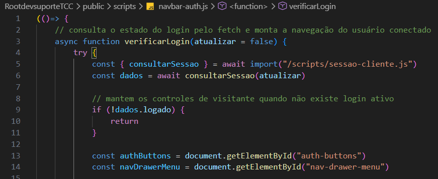

**Print do preenchimento dos avatares:**

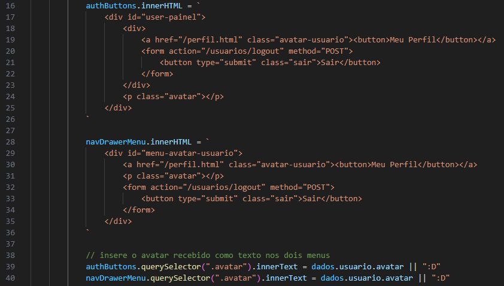

## Como o menu do header abre e fecha

Em **public/scripts/nav-drawer.js**, **toggleMenu()** altera as classes do menu:

```js
menu.classList.toggle("menu-aberto")
menu.classList.toggle("menu-fechado")
```

**classList.toggle** acrescenta a classe quando ela não existe e a remove quando já está presente.

A função também alterna as classes **fa-bars** e **fa-xmark** do ícone.

No mesmo arquivo, o evento **resize** verifica a largura da janela. Quando ela passa de 720 pixels, o código fecha o menu e restaura o ícone de abertura.

Esse menu pertence ao header. Ele é separado do menu de tópicos da página de conteúdo.

**Print do controle do menu:**

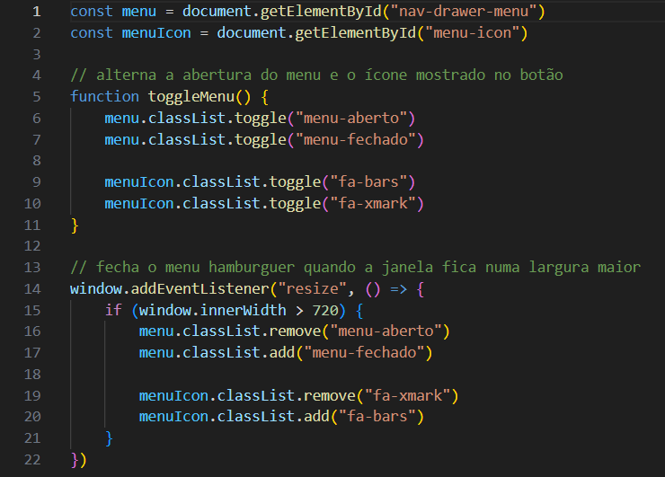

## Como o footer funciona

Em **public/index.html**, o footer reúne os links de navegação e o contato do projeto.

Essa estrutura também é repetida em outras páginas. Ao alterar o contato ou algum link, as cópias precisam ser atualizadas.

Em **public/scripts/email-to-clipboard.js**, **emailToClipboard()** tenta copiar o e-mail de contato usando:

```js
await navigator.clipboard.writeText(email)
```

A função aguarda a conclusão antes de mostrar o alerta de sucesso.

Se a cópia falhar, o **catch** registra o erro no console e mostra o endereço no alerta, permitindo copiá-lo manualmente.

A operação apenas copia o contato. Ela não envia mensagens nem inicia a recuperação de senha.

A página administrativa também carrega esse script, pois seu footer utiliza a mesma função.

A API de área de transferência depende do suporte e das permissões do navegador e de um contexto seguro. O endereço local **http://localhost** é aceito pelos navegadores compatíveis.

**Print da função de copiar o contato:**

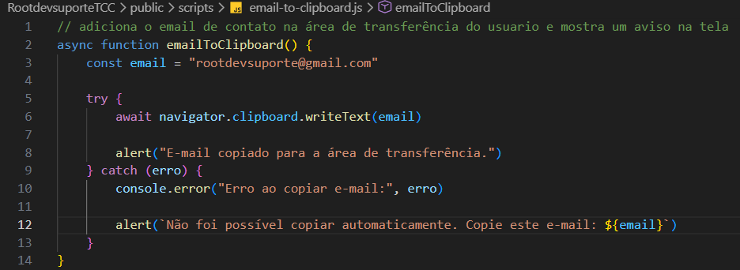

**Print do footer:**


## Como a prévia do avatar é reaproveitada

Em **public/scripts/previa-avatar.js**, **atualizarPreviaAvatar()** lê o campo **avatar** e preenche **avatar-previa**:

```js
previaAvatar.innerText = campoAvatar.value || ":D"
```

A função é executada ao carregar o script e sempre que o evento **input** ocorre no campo.

No cadastro, os elementos já existem quando o script é carregado.

Em **private/admin/admin.js**, a função equivalente é **atualizarPreviewAvatarAdm()**. O formulário de edição é criado dinamicamente, por isso o evento é associado depois que os campos são inseridos.

Em **public/scripts/perfil.js**, **atualizarPreviaPerfil()** realiza a atualização na página de perfil.

Cada função trabalha com os elementos de sua página. Não é necessário carregar o script de prévia do cadastro em todas elas.

**Print da prévia do cadastro:**

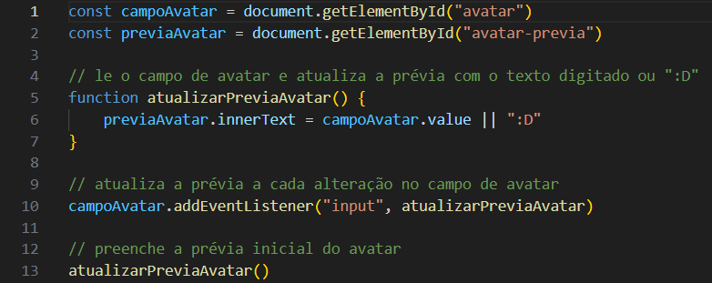

## Por que a ordem dos scripts importa

Em **public/scripts/previa-avatar.js** e nos demais scripts de interface, **document.getElementById** procura elementos do HTML.

Se o script executar antes de esses elementos existirem, a busca pode retornar **null**. Tentar usar **addEventListener** nesse resultado provoca erro.

Em **public/perfil.html**, o script de perfil utiliza **defer**. Isso permite carregar o script e aguardar a leitura do HTML antes de executá-lo.

Em outras páginas, os scripts ficam ao final do HTML, depois dos elementos utilizados.

Em **public/conteudo.html**, Marked e DOMPurify também precisam ser carregados antes do script que usa essas bibliotecas.

O módulo **sessao-cliente.js** é carregado diretamente por **import()** dentro das funções que o utilizam. Não é necessário incluí-lo em uma tag de script separada.

A comunicação de atualização do perfil utiliza o evento **perfil-atualizado**, evitando chamadas diretas a uma função global da navegação.

O ouvinte desse evento precisa estar registrado antes da ação de salvamento. Nas páginas atuais, o script da navegação é carregado durante a preparação da página, antes da interação do usuário.

## Bibliotecas compartilhadas pelo navegador

Em **public/index.html** e nas demais páginas, existem referências a recursos externos:

- **Font Awesome:** disponibiliza os ícones usados na interface.
- **VLibras:** carrega o recurso de acessibilidade em Libras.
- **a11y:** carrega controles adicionais de acessibilidade.

Em **public/conteudo.html**, também são utilizadas:

- **Marked:** converte Markdown para HTML.
- **DOMPurify:** trata o HTML convertido antes da inserção na página.

Essas bibliotecas são carregadas pelo navegador. Elas são diferentes das dependências instaladas pelo npm para o servidor.

A inclusão desses recursos depende de seu carregamento. Ela também não substitui a organização adequada dos campos, botões e textos do HTML.

## Estruturas comuns nas funções

### Objeto vazio quando o corpo está ausente

Em **controller/userController.js**, várias funções começam com:

```js
const dados = req.body || {}
```

Quando **req.body** possui um valor considerado falso pela expressão, **dados** recebe um objeto vazio.

Isso permite acessar propriedades como **dados.nome** sem tentar ler uma propriedade de um corpo ausente.

O objeto vazio não representa dados válidos. As validações ainda precisam verificar se os campos obrigatórios foram enviados e se possuem o tipo esperado.

### Callback das consultas

Em **model/userModel.js**, as funções de consulta recebem callbacks.

Quando a consulta termina, o callback entrega o possível erro e o resultado. Uma chamada como **callback(null, usuarios[0])** informa que não houve erro e devolve o registro encontrado.

O controller continua a operação dentro desse callback, pois o resultado não fica disponível imediatamente após iniciar a consulta.

### Envio e recebimento de JSON

Em **public/scripts/perfil.js**, **salvarPerfil** usa **JSON.stringify** para transformar o objeto enviado em texto JSON.

O cabeçalho **Content-Type: application/json** informa o formato ao servidor.

Na resposta, **resposta.json()** realiza o caminho inverso: lê o JSON recebido e disponibiliza um objeto para o script.

### Verificação de resposta

Em **public/scripts/recuperacao.js**, as funções verificam **resposta.ok** depois do fetch.

O fetch pode receber uma resposta 400 ou 500 sem lançar um erro automaticamente. Por isso, o script precisa conferir o status antes de tratar a operação como concluída.

### Tratamento de falhas

Em **public/scripts/perfil.js**, as operações utilizam **try**, **catch** e **finally**:

- **try:** executa a tentativa.
- **catch:** trata falhas que interrompem a execução.
- **finally:** libera campos e botões quando necessário, mesmo após uma falha.

### Verificação de números inteiros

Em **controller/admController.js**, **Number.isSafeInteger** é utilizado na validação dos identificadores. Em **utils/paginacao.js**, também verifica a página e o deslocamento calculado.

A função verifica se o valor é um número inteiro representado com segurança pelo JavaScript. Ela rejeita valores como números fracionados, **NaN**, infinito e inteiros fora da faixa segura.

O código também precisa conferir se o número é positivo. Essa verificação não substitui a validação de acesso nem os parâmetros das consultas SQL.

## Como as funções respondem ao navegador

Em **controller/userController.js**, o cadastro e o login utilizam **res.redirect** quando funcionam. O navegador é encaminhado para outra página.

Nas operações de perfil, a resposta utiliza **res.json**, pois o script precisa receber uma mensagem ou os dados sem trocar imediatamente de página.

Em **controller/admController.js**, **res.sendFile** envia o HTML e o JavaScript protegidos da página do admin.

Os principais status utilizados no projeto são:

- **200:** operação concluída.
- **201:** comentário criado.
- **202:** solicitação de recuperação aceita para processamento.
- **302:** redirecionamento.
- **400:** dados inválidos.
- **401:** autenticação ou autorização de recuperação ausente ou inválida.
- **403:** operação não permitida.
- **404:** recurso não encontrado.
- **409:** conflito nos dados ou no estado da operação.
- **413:** corpo da requisição acima do tamanho permitido.
- **415:** formato enviado não aceito.
- **429:** limite de tentativas atingido.
- **500:** erro interno do servidor.

O status indica o tipo de resultado. A mensagem enviada explica o problema específico.

## Como os erros são tratados e apresentados

O arquivo **middleware/tratarErros.js** define o middleware global com quatro parâmetros:

```js
function tratarErros(erro, req, res, next)
```

Ele é registrado depois das rotas, para receber as falhas encaminhadas por **next(erro)**.

Se os cabeçalhos já tiverem sido enviados, o middleware encaminha o erro ao próximo tratamento, evitando iniciar outra resposta.

Os tratamentos definidos são:

- JSON inválido: status 400.
- Corpo acima do tamanho permitido: status 413.
- Outras falhas internas: status 500, com mensagem genérica.

O código ou nome do erro interno é registrado no terminal. O middleware não envia o objeto completo do erro ao navegador.

Callbacks de consultas precisam encaminhar suas falhas explicitamente quando utilizam esse tratamento. Uma resposta já enviada diretamente pelo controller não passa novamente por **next(erro)**.

Em **middleware/alertaErros.js**, o sistema adapta a apresentação das respostas enviadas por **res.send** ou **res.json**.

Quando o status é de erro e a requisição solicita HTML, o middleware envia uma página curta que mostra um alerta. Ao fechar a mensagem, o navegador retorna à página anterior ou ao início, quando não existe histórico suficiente.

A mensagem é preparada com **JSON.stringify** e escapes antes de ser inserida no script.

Quando a requisição aceita JSON como formato selecionado, o conteúdo continua sendo enviado normalmente. Os scripts de perfil, recuperação e administração leem essa resposta e apresentam suas próprias mensagens.

Assim, os formulários comuns recebem um aviso visível, e as consultas por JavaScript mantêm respostas que podem ser processadas pelo código.

## Responsividade do header e do footer

Em **public/styles/global.css**, os blocos **@media** adaptam os elementos compartilhados:

- Até **720 pixels**, os controles comuns do header são escondidos e o menu compacto passa a ser utilizado.
- Até **776 pixels**, o ícone dentro de **.title** é escondido.
- Até **470 pixels** e **428 pixels**, textos e controles recebem ajustes de tamanho.
- Até **1100 pixels**, o footer passa a se organizar em coluna.
- Até **768 pixels**, as áreas internas do footer também são organizadas em coluna.

As regras podem se somar quando a largura atende a vários limites.

**Print da responsividade do header:**

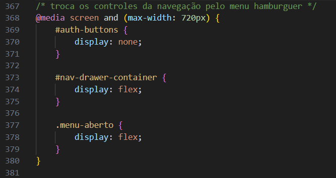

**Print da responsividade do footer:**

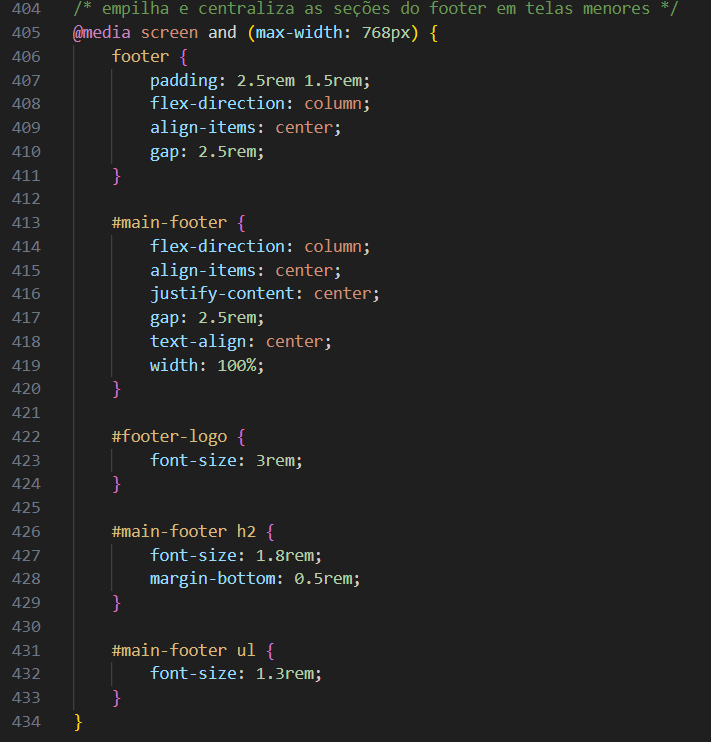

**Print do menu em tela de celular:**

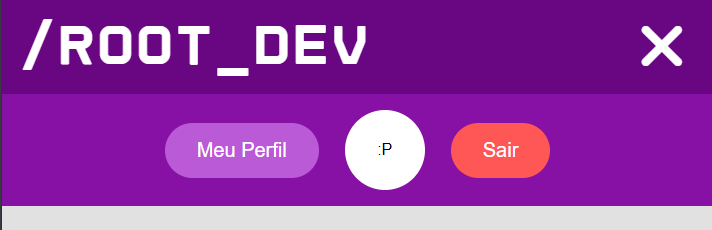

## Responsividade dos formulários compartilhados

Em **public/styles/cadastro-login.css**, as regras são utilizadas pelas páginas que carregam esse arquivo, incluindo cadastro, login, perfil, recuperação e edição do admin.

- Até **688 pixels**, **.campo** passa a organizar seus elementos em coluna.
- Até **475 pixels**, a caixa do formulário recebe ajustes de espaço.
- Até **428 pixels**, a largura e os textos recebem outros ajustes.
- A partir de **430 pixels**, a caixa utiliza uma largura proporcional com limite.
- A partir de **900 pixels**, a largura máxima passa a ser 600 pixels.

A aplicação de cada regra depende das classes e dos ids presentes no HTML.

**Print da organização dos campos em telas menores:**

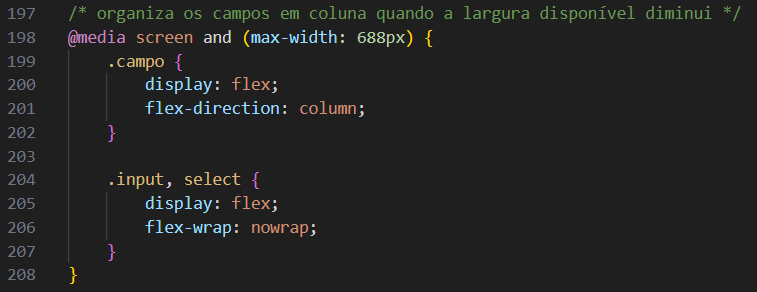

## Responsividade da página inicial

Em **public/styles/index.css**, até **768 pixels**, a introdução recebe ajustes de espaço e tamanho de texto.

Até **545 pixels**, o título de JavaScript utiliza uma medida proporcional à largura da tela para caber melhor.

A responsividade específica das aulas está em **DOC_CONTEUDOS.md**, e a das consultas está em **DOC_ADMIN.md**.

## Como adicionar uma página com os recursos compartilhados

Use **public/index.html** como referência para o header e o footer. Mantenha os ids utilizados pelos scripts.

Inclua **public/styles/global.css** e os scripts correspondentes aos recursos usados pela página.

Os scripts precisam executar depois que seus elementos estiverem disponíveis. Para isso, mantenha-os ao final do HTML ou utilize **defer**, como em **public/perfil.html**.

Se a página precisar consultar o servidor, adicione a rota ao grupo adequado e defina a função do controller. Quando houver consulta ou alteração no banco, utilize uma função de model.

Em **index.js**, outro **app.use** só é necessário quando for criado um novo grupo de rotas.

As ações que precisam aparecer nos relatórios devem registrar o resultado conforme **DOC_LOGS.md**.

A proteção de uma operação deve existir no servidor. Esconder um botão ou formulário apenas controla sua apresentação na página.