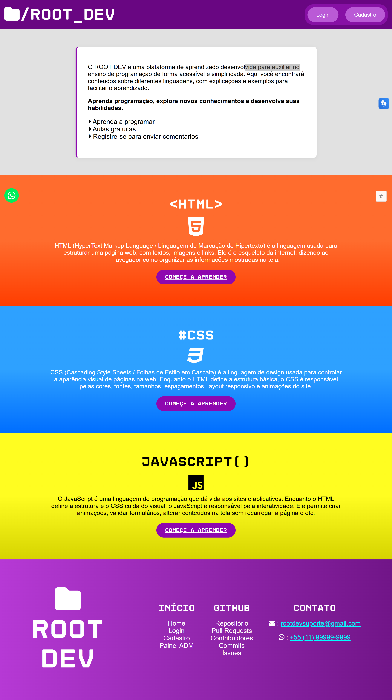
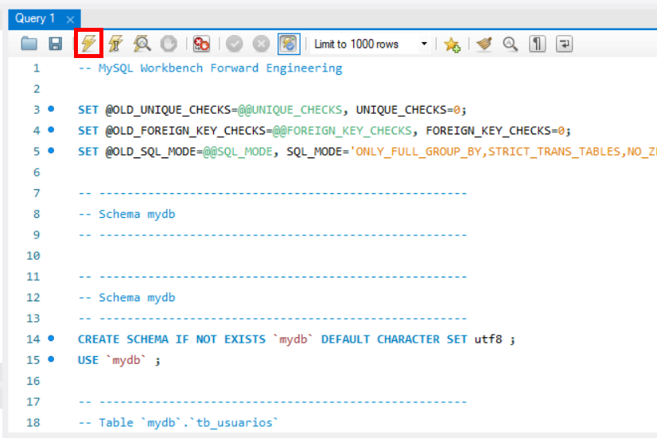
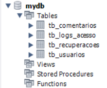
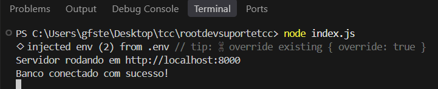
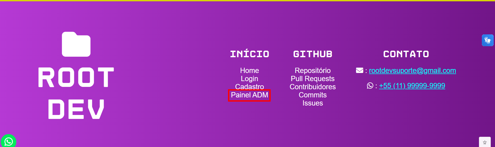
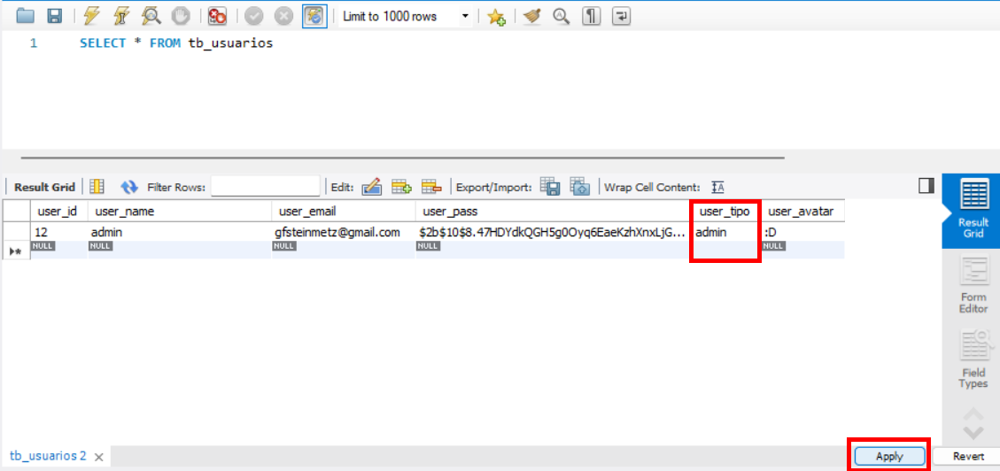
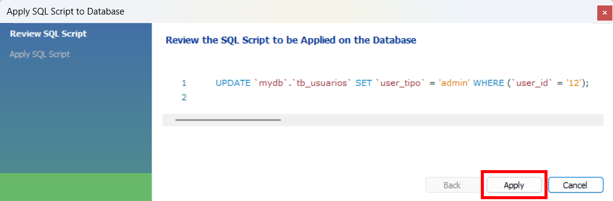

# ROOT DEV

O ROOT DEV é uma plataforma de conteúdos didáticos sobre HTML, CSS e JavaScript, desenvolvida como projeto do TCC do curso de Desenvolvimento de Sistemas. As aulas ficam em arquivos Markdown, os dados dos usuários e suas interações são armazenados no MySQL.

**Página inicial:**



## Funcionalidades

- Cadastro, login, edição e exclusão de perfil.
- Recuperação de senha por e-mail.
- Aulas organizadas por categorias e tópicos.
- Pesquisa de conteúdos.
- Publicação, consulta e exclusão de comentários.
- Página do admin com pesquisa e paginação de usuários, comentários e logs.
- Registro de logs do sistema.
- Responsividade e bibliotecas de acessibilidade.

O projeto funciona da forma correta em navegadores baseados em Chromium, como Chrome e Edge.

## Tecnologias e bibliotecas

- **HTML, CSS e JavaScript:** interface e interações.
- **Node.js e Express:** servidor e rotas.
- **MySQL e mysql2:** armazenamento e acesso ao banco.
- **bcrypt:** hash de senhas e códigos de recuperação.
- **express-session:** sessões dos usuários.
- **express-rate-limit:** limitação de requisições.
- **Nodemailer e Gmail:** envio de e-mails.
- **dotenv:** leitura das configurações do arquivo **.env**.
- **Markdown, Marked e DOMPurify:** escrita, conversão e filtragem das aulas.
- **Font Awesome:** ícones.
- **VLibras e @pigmilcom/a11y:** recursos de acessibilidade.

## Estrutura MVC

O projeto utiliza a estrutura MVC:

- **model:** executa as consultas no banco.
- **public e private:** contêm as páginas e os recursos da interface.
- **controller:** recebe as solicitações, valida os dados e organiza
  as respostas.
- **service:** reúne autenticação, criptografia, preparação do cadastro,
  recuperação de senha e envio de e-mail.
- **utils:** reúne funções compartilhadas de sessão, paginação e
  normalização dos dados.
- **middleware:** verifica o acesso administrativo e trata os erros.
- **routes:** encaminha as requisições aos controllers.
- **content:** armazena as aulas em Markdown.
- **Doc:** contém a documentação dos fluxos e códigos.

## Programas necessários

- Node.js e npm.
- MySQL Server.
- MySQL Workbench para criar e consultar o banco.
- Git para clonar o repositório.
- Navegador atualizado com JavaScript habilitado.

## Instalação

### Baixando o projeto

No terminal, execute:

```
git clone https://github.com/RootdevsuporteTCC/RootdevsuporteTCC.git
cd RootdevsuporteTCC
npm ci
```

O comando `npm ci` instala as dependências nas versões registradas em
`package-lock.json` e cria a pasta `node_modules`.

Também é possível baixar e extrair o ZIP do repositório. Nesse caso, abra
o terminal na pasta que contém `package.json` e execute `npm ci`.

### Preparando o banco

1. Abra o MySQL Workbench e abra alguma conexão.
2. Copie o código do arquivo "comandoSQL.sql"
3. Cole o código no workbench e execute



O arquivo **MER tcc.mwb** contém o modelo do banco e pode ser aberto no Workbench para visualizar os relacionamentos.

Configure a conexão pelo arquivo `.env`, localizado na mesma pasta de
`index.js`:

- `DB_HOST`: endereço do MySQL; use `localhost` para instalação local.
- `DB_PORT`: porta da conexão, normalmente `3306`.
- `DB_USER`: usuário do MySQL.
- `DB_PASSWORD`: senha desse usuário.
- `DB_NAME`: nome do banco criado pelo SQL.

Host, porta e usuário podem ser consultados em **Edit Connection** no
MySQL Workbench. A senha é a definida para o usuário do banco.

O banco utiliza `utf8mb4`, permitindo armazenar emojis. O servidor utiliza
um pool de conexões e verifica o acesso ao banco antes de iniciar.

**Print do banco:**



### Configuração e e-mail

A pasta `node_modules` não faz parte do repositório e deve ser criada
com `npm ci`. Mantenha `package.json` e `package-lock.json`.

O arquivo `.env` também contém:

- `PORT`: porta do site, normalmente `8000`.
- `SESSION_SECRET`: chave usada para assinar o identificador da sessão.
- `SMTP_USER`: conta remetente dos e-mails de recuperação.
- `SMTP_PASS`: senha de aplicativo dessa conta.

As configurações de e-mail fornecidas com o projeto podem ser mantidas
para utilizar a conta remetente existente.

O envio de e-mails e os recursos carregados por links externos precisam
de acesso à internet.

## Iniciando o servidor

Abra um terminal na pasta principal do projeto (onde tem o arquivo **index.js**), pode ser via CMD, PowerShell ou pelo terminal do VS Code.

Execute:

```
npm start
```

Mantenha o terminal aberto e acesse:

http://localhost:8000

Se `PORT` tiver outro valor no `.env`, utilize essa porta no endereço.

O terminal deve permanecer aberto. Para encerrar o servidor, pressione
Ctrl + C. Acesse o projeto pelo endereço do servidor; abrir o HTML
diretamente ou pelo Live Server não disponibiliza o backend.

As sessões ficam na memória do servidor. Reiniciar o Node encerra os
logins ativos.

Para fechar o servidor, pressione **Ctrl + C** no terminal. O site deve ser aberto por esse link, abrir o HTML direto ou pelo Live Server não se conecta ao back-end.

**Print do servidor:**



## Criando o 1º admin

1. Cadastre uma conta pelo site.
2. No MySQL Workbench, selecione o banco do projeto.
3. Execute:

```sql
SELECT * FROM tb_usuarios;
```

4. No resultado, encontre a conta cadastrada.
5. De 2 cliques no bloco de **user_tipo** dessa conta e substitua **usuario** por **admin**.
6. Clique em **Apply**.
7. Confira o comando e clique em **Apply**. Depois em **Finish**.

O cadastro continuará utilizando o mesmo e-mail e senha.

Abra a página de login do admin:



**Print da alteração do tipo:**



**Print da confirmação:**



## Documentação

A pasta **Doc** explica os códigos e os fluxos de cadastro, login, perfil, conteúdos, comentários, admin, logs, recuperação de senha e banco de dados.

As instruções para adicionar aulas estão em `Doc/DOC_CONTEUDOS.md`.

Após adicionar, alterar ou remover aulas, reinicie o servidor. O menu,
a abertura das aulas e a pesquisa utilizam o mesmo cache, preenchido
na inicialização apenas com aulas válidas.